# Workflow diagrams

One diagram per Machine in this repository, drawn from the state names in the
source. The [catalog](catalog.md) has the inputs, results, and limits; this page
shows how a run moves. Nodes carry a short note where the name alone does not
say what the state does.

| Shape | Kind | What it means |
| --- | --- | --- |
| 🤖 rounded | Agent | A model call through a bound role. Its word is never the last word. |
| ⚙️ box | Operation | Plain code: bookkeeping, Git, budgets, judging a report. |
| 🧪 hexagon | Check gate | Runs real commands and keeps their exit codes and logs. |
| 🙋 slanted | Human | Waits for a person's choice. A Machine never invents one. |
| circle | End | Every end of a default writes `result.json` in the evidence folder. |

The defaults share one idea: an Agent edits, the Machine checks, another Agent
reviews a *sealed* checkout, and a small repair budget decides whether to try
again. Read-only stages are fingerprinted before and after, so a reviewer that
edits a file blocks the run instead of slipping a change through.

- [verify-checks](#verify-checks)
- [implement-task](#implement-task)
- [fix-bug](#fix-bug)
- [refactor](#refactor)
- [add-tests](#add-tests)
- [update-docs](#update-docs)
- [review-code](#review-code)
- [investigate](#investigate)
- [upgrade-dependency](#upgrade-dependency)
- [prepare-release](#prepare-release)
- [ticket-task](#ticket-task)
- [chatgpt-thread](#chatgpt-thread)
- [smoke](#smoke)

## verify-checks

No model at all. The cheapest way to get a receipt that the checks really ran.
[Source](../defaults/verify-checks.ts)

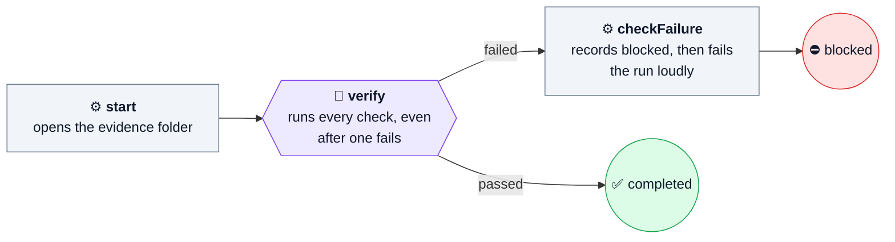

## implement-task

The plain feature loop. [Source](../defaults/implement-task.ts)

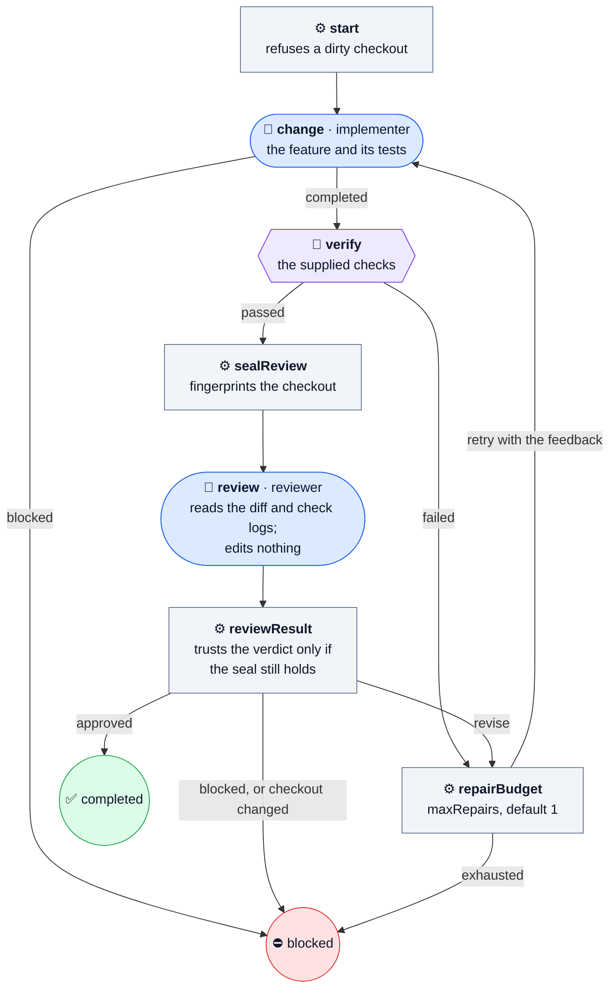

## fix-bug

The bug has to be caught on camera before anyone fixes it.
[Source](../defaults/fix-bug.ts)

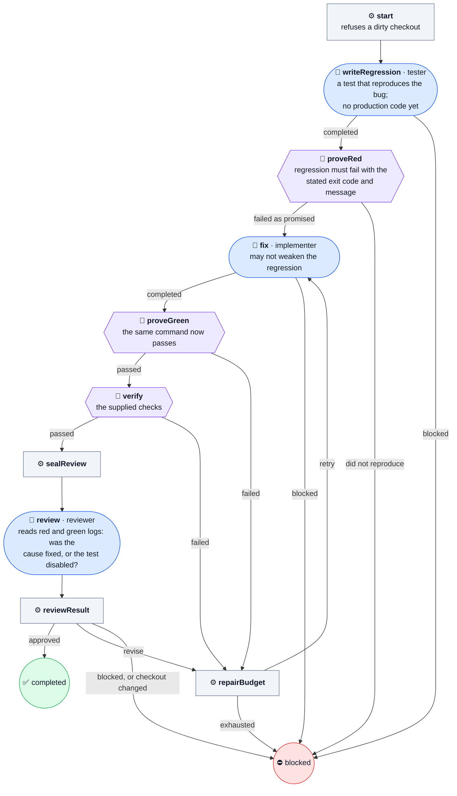

## refactor

The checks pass before the change and are the contract after it.
[Source](../defaults/refactor.ts)

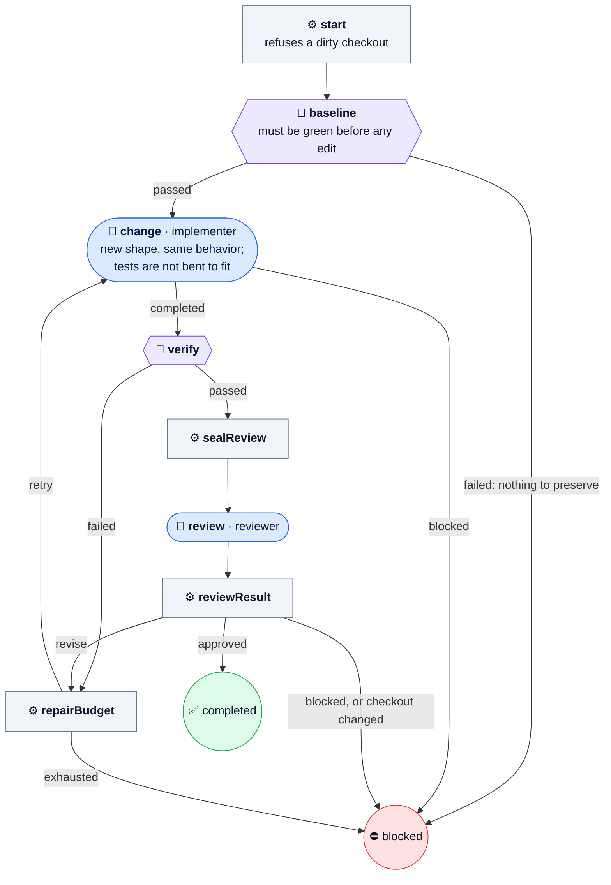

## add-tests

Same shape as refactor, with a tester instead of an implementer.
[Source](../defaults/add-tests.ts)

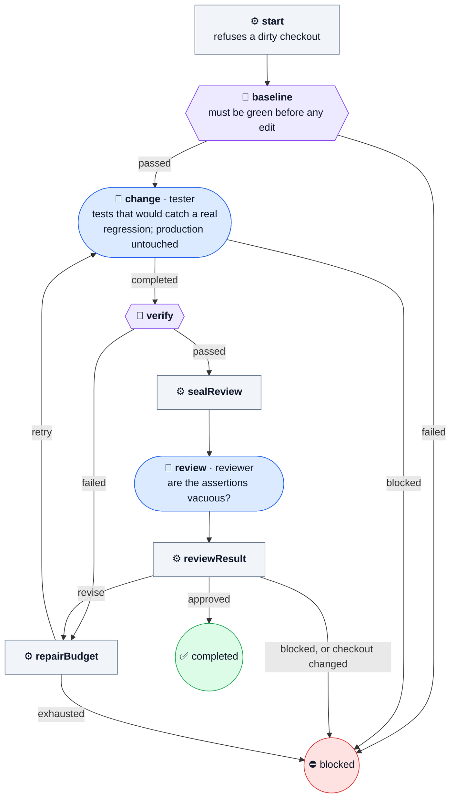

## update-docs

[Source](../defaults/update-docs.ts)

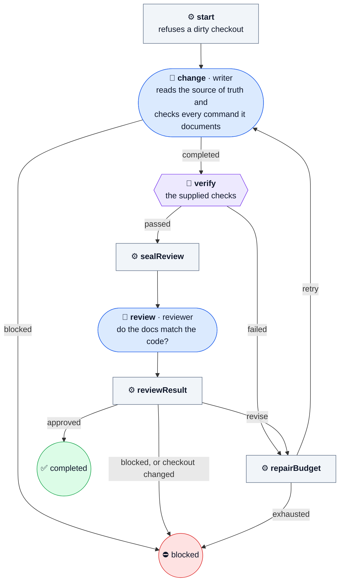

## review-code

One call, no edits. Works on a dirty checkout, since that is often what is being
reviewed. [Source](../defaults/review-code.ts)

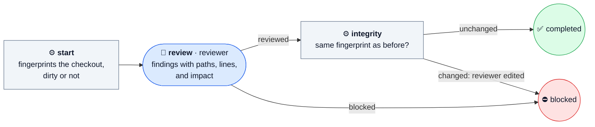

## investigate

A diagnosis has to survive a skeptic before it is reported.
[Source](../defaults/investigate.ts)

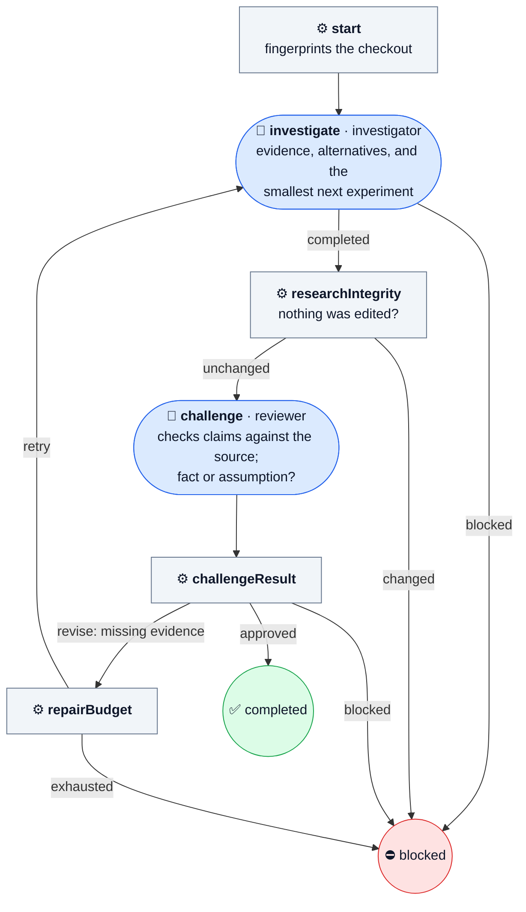

## upgrade-dependency

Nothing is installed until a person approves the plan.
[Source](../defaults/upgrade-dependency.ts)

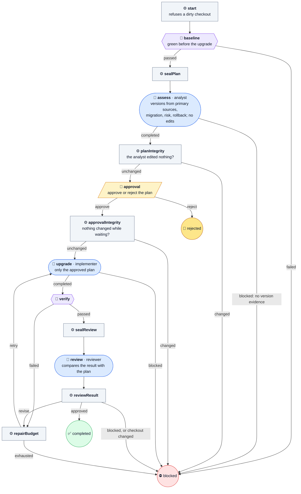

## prepare-release

Gets a candidate ready for a person to sign off. It never tags, pushes, or
publishes. [Source](../defaults/prepare-release.ts)

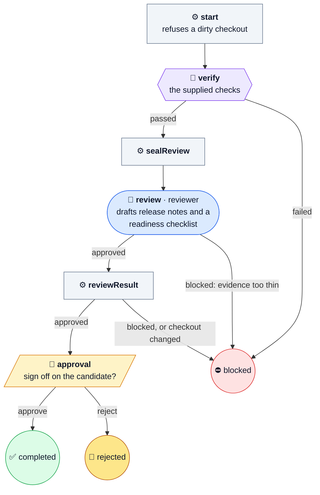

## ticket-task

The big one: a local ticket carried from an isolated worktree to a delivered
branch, patch, or pull request. Planning is read-only, tests come first by
default, and the Machine, not the reviewer, decides whether a review passed.
[Source](../ticket-task.ts) · [details](catalog.md#ticket-delivery)

Any setup, commit, archive, or delivery failure ends ⛔ blocked; those edges are
left out to keep the picture readable.

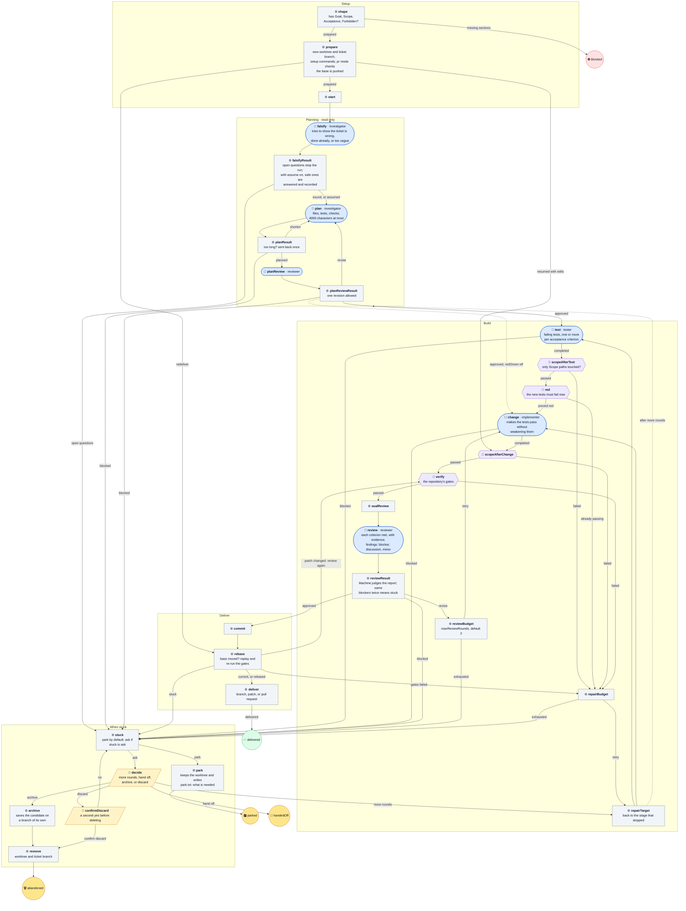

## chatgpt-thread

Keeps one ChatGPT web chat going, with a person writing every reply. It types
into your own account. [Source](../chatgpt-thread.ts) ·
[details](catalog.md#chatgpt-thread)

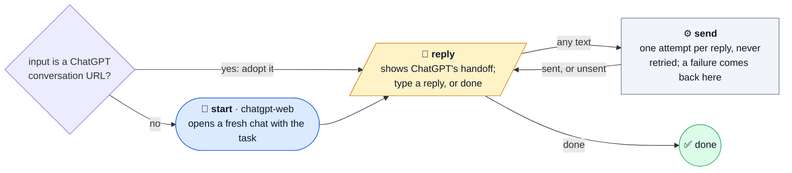

## smoke

Proves the runtime can load a definition from here. No model, no checks.
[Source](../smoke.ts)

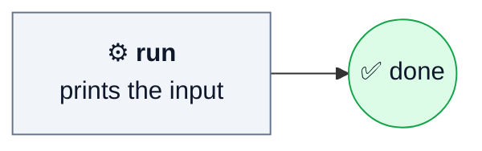
