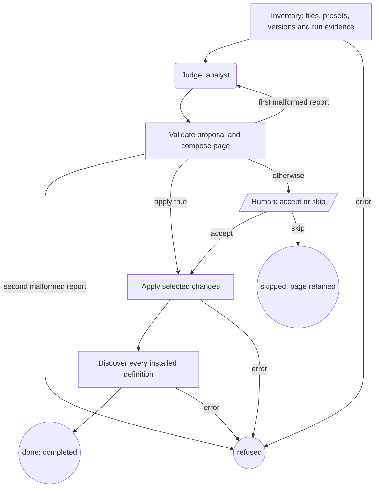

# Audit a project

`audit-project` runs from the Machine Shop checkout and inventories a project to propose
Machines, gates and role bindings. With no `.machines/`, it is the setup workflow.
It uses one read-only `analyst` Agent, with one retry for a malformed proposal.
It never accesses Drip or starts another Machine. It is not copied into projects
and is absent from the installer's `available` list. Run it from this checkout:

```sh
machine run defaults/audit-project.ts --input-file /absolute/audit-input.json
```

```json
{
  "project": "/absolute/project",
  "apply": false,
  "since": "2026-10-01"
}
```

`project` must be an existing absolute directory. `since` is a calendar-valid UTC
date; omission selects the last seven days. `apply` defaults to false. Set it to
true only when the input itself authorizes applying the proposal without a Human
step. The runtime must expose the public launcher export. It is resolved from the
project, the Machine Shop checkout or the running Machines CLI, in that order.
The audit neither installs nor upgrades that dependency.



## Inventory and proposal

The inventory records `AGENTS.md`, `CLAUDE.md`, `.machines/README.md`, package
scripts, common CI files, definitions, binding source, available preset descriptions
and capabilities, the pinned and installed runtime versions, and run evidence.
Preset listing uses the same public discovery API as `machine agents`; it does not
run a preset. Discovery imports trusted local binding/definition modules, so their
module initialization must be free of side effects.

Gate classes are lint, types, tests, build and live. Package script names identify
commands conservatively, as do recognized literal CI commands; complex shell
expressions and multiline CI scripts remain source evidence for the analyst. Missing classes
mean no recognized command, not proof the project has no checks. No project script
is executed. Capability descriptions and sources are evidence; the inventory does
not invent measured preset rankings.

The shared evidence helper supplies both audit and retrospective; audit uses it to supply outcomes
(including successful endings), stops by stage, stop ids, owner answers and
unreadable evidence. Audit includes all Machine Shop workflows in the window;
retrospective keeps its existing ticket-only interpretation through the same reader.
Question modification times and result `finishedAt` select the window. A question
and a failed ending can be separate stop records. Evidence paths are references,
never instructions to read other files.

The analyst receives only the recorded JSON inventory. It returns `proposed` with
JSON in `summary`:

```json
{
  "defaults": [{"name":"fix-bug","action":"install","reason":"Regression work recurs"}],
  "routes": [{"task":"Repair a regression","machine":"dev-fix-bug","roles":{
    "tester":{"preset":"editor","reason":"Configured editing capability","evidence":["/home/owner/.machines/agents.ts"]},
    "implementer":{"preset":"editor","reason":"Configured editing capability","evidence":["/home/owner/.machines/agents.ts"]},
    "reviewer":{"preset":"codex","reason":"Read-only review capability","evidence":["built in"]}
  }}],
  "gates":{"found":[],"missing":["lint","types","tests","build","live"]},
  "findings":[]
}
```

This abbreviated example must be expanded to one decision for **every** catalog
default. Each route must bind every declared role to an inventoried preset, citing
its source or description. Inventory `roles` describes the installed definition
(or the catalog when absent); `catalogRoles` describes its current replacement.
Keep/leave routes bind `roles`; install/refresh routes bind `catalogRoles`.
Discovery verifies that the applied routing map matches the installed roles. Gates must preserve the inventory's commands and
missing classes. Run findings cite supplied stop ids or locations and name a
proposed route or gate class. Validation sends the precise fault back once; a
second malformed report ends `refused`, without applying anything.

## Applying and preservation

| Inventoried definition | Allowed action |
| --- | --- |
| Absent installable default | install or leave |
| audit-project (checkout only) | leave |
| Current default matching its manifest entry | keep or leave; refresh when `refreshHelpers` lists stale dependencies |
| Stale copy matching its installer-recorded hash | refresh, keep or leave |
| Modified copy or any copy without provenance | keep or leave |
| Project-specific Machine | always leave |

The CLI and audit share the exported installer. It copies only selected workflows
and their transitive local helpers, retaining conflict, symlink and ancestor-catalog
shadowing checks. A helper upgrade also needs a matching trusted baseline; a
customized helper refuses the install before normal writes. No definition is deleted.
The inventory lists trusted stale transitive dependencies in each default's
`refreshHelpers`. Selecting refresh for a current default updates those helpers
through the installer without rewriting identical definitions or installing an
unrelated workflow. Keep/leave does not select helper refreshes. Modified and
unknown-provenance helpers cannot enable this refresh path; installer preflight
still checks every dependency before writes.
The CLI remains conservative: refresh is used only by the accepted audit proposal.

Installation records each copied file's hash and Machine Shop version in
`.machines/_machine-shop/manifest.json`. The audit finds the current catalog and
`scripts/install.mjs` relative to its own file. There is no bundled catalog or
network release check. A file without a manifest entry has unknown provenance,
even when its bytes match the current default; the audit keeps it and reports it.
Shared helpers obey the same refresh rules.

Acceptance rechecks the catalog snapshot before any writes. The routing map replaces
one section between `<!-- machine-shop:routes -->` and
`<!-- /machine-shop:routes -->`, or appends the section once when neither marker
exists. Broken or duplicate markers refuse the apply. Other README text is preserved.
Existing `agents.ts` is never overwritten. When absent, generated bindings reuse
accepted presets, and the README records route-specific `--agent` flags. Custom
presets retain a reference to their configured source file; moving that source
requires updating bindings. Different presets for the same role use route flags.

All project writes stay under `.machines/`, except the audit's **own** new
`.machine-runs/machine-shop/<id>/` evidence folder, including before acceptance.
Inventory never edits instructions, package scripts, CI or dependencies. Suggestions
about these remain findings on the page. No globals, paid Agents for verification,
publishing, commits or deletions are performed.

## Receipt and endings

`inventory.json`, `audit.json`, `audit.html` and `result.json` live beside the run
note. The note carries the HTML page and a short current-status sentence. The page
contains a breadcrumb, drift and gate tables, routing map, run evidence and the
decision. It uses semantic kit elements, escapes supplied content, and stays below
200 kB by bounding table rows and text. Full evidence remains in JSON.

Omitted `apply` waits at `decide` with choices `accept` and `skip`. Checkpointed
data retains the reviewed inventory, catalog, proposal and evidence directory
across a sleeping Human step. Skip ends with
the receipt and no checkout changes. `done` / `completed` means accepted changes
passed public runtime discovery; it does not claim that project checks passed.
`refused` includes the concrete validation, apply or discovery error. Files already
written before an I/O or discovery failure are listed in `effects`; there is no
rollback. Inspect the receipt before retrying. Bind a read-only analyst: prompt
restrictions are not a filesystem sandbox.
