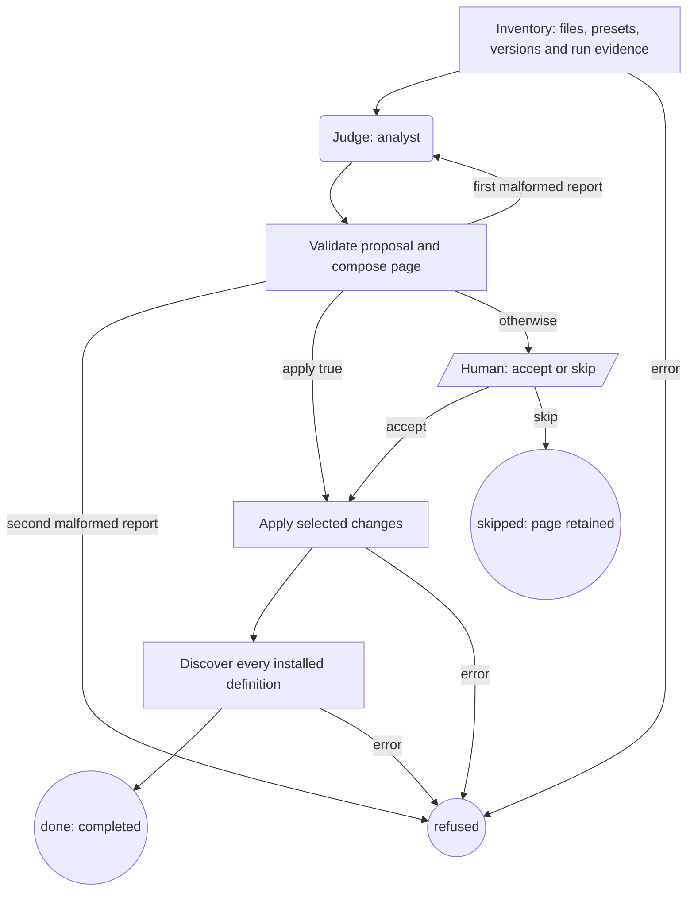

# Audit a project

`audit-project` runs from the Machine Shop checkout and inventories a project to propose
Machines, gates and role bindings. With no `.machines/`, it is the setup workflow.
It uses one read-only `analyst` Agent, with one retry for a malformed proposal.
By default it makes no project-agent inspection or external service call. It never starts another Machine. It is not copied into projects
and is absent from the installer's `available` list. Run it from this checkout:

```sh
machine run defaults/audit-project.ts --input-file /absolute/audit-input.json
```

```json
{
  "project": "/absolute/project",
  "apply": false,
  "since": "2026-10-01"
}
```

`project` must be an existing absolute directory. `since` is a calendar-valid UTC
date; omission selects the last seven days. `apply` defaults to false. Set it to
true only when the input itself authorizes applying the proposal without a Human
step. The runtime must expose the public launcher export. It is resolved from the
project, the Machine Shop checkout or the running Machines CLI, in that order.
The audit neither installs nor upgrades that dependency.

## Optional shared project-agent inspection

Project setup can teach one reusable project-agent binding. Audit can inspect that
same binding through a caller-selected adapter. Drip feedback is the first consumer;
Overlord is one possible provider. Neither is required. Omit `projectAgent` to retain
the existing behavior: no inspection command, new external calls or readiness claim.
This is an integration with the provider's binding, not a second registry or scheduler.

Discover the installed provider's **supported interface** using its documentation
or supported help before configuring an adapter. The caller supplies trusted argv;
the analyst never discovers or generates commands from project prose. The adapter
uses that interface without reading private databases/configuration or probing
readiness through a model or manager request. Use a generic adapter until the
installed Drip inspection/setup contract can be verified; the following example
does not assert any Drip CLI flags. Replace these illustrative adapter paths with
your trusted local adapter and its supported arguments:

```json
{
  "project": "/absolute/project",
  "projectAgent": {
    "inspect": ["node", "/absolute/trusted-provider-adapter.mjs", "inspect", "/absolute/project"],
    "setup": {
      "command": ["node", "/absolute/trusted-provider-adapter.mjs", "setup", "/absolute/project"],
      "effects": "Creates or repairs the shared project binding; may start a service, provision a manager, grant writes or incur model charges. Invoke separately under the provider's permission contract."
    }
  }
}
```

`inspect` is required when `projectAgent` is supplied. `setup` is optional, but when
present needs both `command` and a plain-language `effects` description. Both commands
are nonempty argv arrays, with a nonblank executable and no NUL characters. Empty
argument strings are allowed. Each array has at most 100 words and 8,000 UTF-8 bytes
when JSON encoded; effects have at most 4,000 characters. The quoted setup command
and effects also share a 16,000-byte escaped display budget (conservatively counting
each HTML special character as six bytes), so the complete route fits the page.
No shell, environment or
permission fields are accepted. Keep credentials out of argv, effects and JSON;
authentication belongs to the supported provider interface.

The inventory Operation executes inspection once, from the audited project, with
no shell or stdin, a **10-second** timeout and a **64 KiB** combined stdout/stderr
limit. Stdout must contain one JSON object. Stderr counts toward the bound but is
never persisted; unsuccessful exits and raw error output are not treated as evidence
of readiness. No command is run when this integration is absent.

The version-one adapter contract is:

```json
{
  "version": 1,
  "project": "/canonical/absolute/project",
  "observedAt": "2026-10-22T16:00:00.000Z",
  "binding": { "reference": "example://project-agent/binding-17", "revision": "revision-42" },
  "provider": { "id": "example-provider", "name": "Example provider" },
  "agent": { "id": "shared-agent-17", "name": "Shared project agent" },
  "capabilities": ["feedback", "read-project"],
  "limits": ["Snapshot only; no write-access or enforcement guarantee"],
  "state": "ready",
  "explanation": "Provider observed this project's binding ready at observedAt."
}
```

All fields are required. `project` must exactly match the audited directory's
canonical path (`realpath`); a different or relative identity cannot establish readiness.
`observedAt` is a UTC ISO timestamp: future observations and observations older than
the **five-minute** freshness limit are findings. Audit reassesses this limit at
publication, acceptance and resume using the saved observation, without another probe.
The example timestamp is illustrative; a real adapter supplies the inspection time.

`state` is `missing`, `ready`, `offline`, `wrong-project` or `unsupported`.
`provider` always identifies the actual provider; `agent` and `binding` may be explicit
`null` when unavailable (for example, missing). `ready` requires both agent identity
and binding `reference` and `revision`. A reference is opaque data, never a URL to
fetch or command to execute. Capabilities and limits are arrays of at most 100
nonblank strings, including provider-specific restrictions. Strings are at most
4,000 characters, without NULs. Unknown fields, including credentials, environment,
permissions or setup commands, invalidate the schema and are discarded. The adapter
must return credential-free explanations and identifiers; audit cannot infer secrets
hidden inside otherwise valid prose. Malformed JSON/schema, launch failure, timeout,
oversized output, unsuccessful exit, stale evidence or mismatched identity produce
actionable findings without hiding the ordinary workflow audit.

`projectAgent` in `inventory.json`, `audit.json` and `result.json` contains the same
`observation`, local `inspectedAt` time, deterministic `findings` and `nextActions`. Its status distinguishes
`inspected` (a recent ready observation), `setup-needed` (a provider-reported gap),
and `unverifiable` (inspection cannot establish readiness). A timestamp that was
future-dated at inspection stays invalid on resume, even if the clock catches up.
The HTML shows the same
assessment, provider/agent identities, binding reference/revision and reported limits.
All content is escaped data. Long evidence cells are shortened; JSON retains full facts.
These are observations, not enforcement guarantees. Applying workflows cannot mark a
binding repaired, and analyst claims cannot replace an observation or its assessment.
Project-agent findings are separate from the analyst's Machine-route/gate findings;
the existing route and gate validation still applies.

For a finding, a supplied setup route appears as a **separate next action** containing
the exact argv `command`, its effects, and a POSIX shell-quoted `display`. Display is
data, not an execution instruction to audit. Without a supplied route, audit explains
the gap and asks the caller to discover the provider's supported setup interface.
After reviewing the audit, invoke setup separately under that interface's permission
contract, then run a fresh audit to inspect the resulting binding. Setup skills should
use the documented caller-supplied route and effects rather than invent provider commands.
The coordinating project owns the Machines setup-skill follow-up to this contract.

**Neither audit acceptance nor `apply: true` executes setup.** Those decisions authorize
workflow installation only, not service starts, manager provisioning, write grants or
paid requests. The generated map records only the binding reference and caller-supplied
supported setup route/effects; it does not copy the runtime binding, identity, capabilities
or revision into `.machines/README.md`. Customized map sections and existing bindings
retain the preservation rules below.



## Inventory and proposal

The inventory records `AGENTS.md`, `CLAUDE.md`, `.machines/README.md`, package
scripts, common CI files, definitions, binding source, available preset descriptions
and capabilities, the pinned and installed runtime versions, and run evidence.
Preset listing uses the same public discovery API as `machine agents`; it does not
run a preset. Discovery imports trusted local binding/definition modules, so their
module initialization must be free of side effects.

Gate classes are lint, types, tests, build and live. Package script names identify
commands conservatively, as do recognized literal CI commands; complex shell
expressions and multiline CI scripts remain source evidence for the analyst. Missing classes
mean no recognized command, not proof the project has no checks. No project script
is executed. Capability descriptions and sources are evidence; the inventory does
not invent measured preset rankings.

The inventory also computes slow always-check findings for every valid check in
`.machines/gates.json`, including names such as `ui` that match no gate class.
A check taking **more than two minutes** without nonempty `when` globs or
`focused: true` gets a finding in `slowChecks.checks` and its own page table.
The audit reads only `checks[].durationMs` from
`.machine-runs/machine-shop/*/result.json`; it never runs checks to measure them.
It selects the most recent whole `verify` entry by the run's `finishedAt` within
the audit window, taking the last whole entry within a run. Focused executions
are excluded; whole repair executions count. Missing, malformed or symlinked
duration evidence is ignored. Verify receipts are not a duration source.

Suggested `when` globs use existing, non-symlinked top-level directories named
in the command or its called package script (`npm`, `pnpm` or `yarn run`, or
`npm test`), including forwarded arguments. Package runner verbs and script
names, dot-directories and `node_modules` are excluded. Suggestions remain empty
when no directory is supported by that evidence. The audit never applies them.
If a gate list has no usable recorded durations, `slowChecks.note` and the page
show one note to run the project's checks through a Machine Shop workflow
(a ticket or `dev-verify-checks`), which records `durationMs` for the next audit.
A project without a valid gate list gets neither a finding nor that note.

The shared evidence helper supplies both audit and retrospective; audit uses it to supply outcomes
(including successful endings), stops by stage, stop ids, owner answers and
unreadable evidence. Audit includes all Machine Shop workflows in the window;
retrospective keeps its existing ticket-only interpretation through the same reader.
Question modification times and result `finishedAt` select the window. A question
and a failed ending can be separate stop records. Evidence paths are references,
never instructions to read other files.

The analyst receives only the recorded JSON inventory. It returns `proposed` with
JSON in `summary`:

```json
{
  "defaults": [{"name":"fix-bug","action":"install","reason":"Regression work recurs"}],
  "routes": [{"task":"Repair a regression","machine":"dev-fix-bug","roles":{
    "tester":{"preset":"editor","reason":"Configured editing capability","evidence":["/home/owner/.machines/agents.ts"]},
    "implementer":{"preset":"editor","reason":"Configured editing capability","evidence":["/home/owner/.machines/agents.ts"]},
    "reviewer":{"preset":"codex","reason":"Read-only review capability","evidence":["built in"]}
  }}],
  "gates":{"found":[],"missing":["lint","types","tests","build","live"]},
  "findings":[]
}
```

This abbreviated example must be expanded to one decision for **every** catalog
default. Each route must bind every declared role to an inventoried preset, citing
its source or description. Inventory `roles` describes the installed definition
(or the catalog when absent); `catalogRoles` describes its current replacement.
Keep/leave routes bind `roles`; install/refresh routes bind `catalogRoles`.
Discovery verifies that the applied routing map matches the installed roles. Gates must preserve the inventory's commands and
missing classes. A project's own `.machines/gates.json` is read as an instruction file, and
each check whose name reads as a class (lint, types, tests, build; smoke, package or install as live)
is a found gate with its command as written. Findings cite a stop id or location, an
instruction or CI file key, or a found gate name, and name a
proposed route or gate class. An instruction key the inventory records as `null`
(the project has no such file) is valid evidence that the file is missing, so a
finding such as "no gate list declared" may cite `.machines/gates.json`.
Validation sends the precise fault back once, naming the finding by index, route
and reason together with each evidence item the inventory does not hold, or the
unknown route; a second malformed report ends `refused`, without applying anything.

## Applying and preservation

| Inventoried definition | Allowed action |
| --- | --- |
| Absent installable default | install or leave |
| audit-project (checkout only) | leave |
| Current default matching its manifest entry | keep or leave; refresh when `refreshHelpers` lists stale dependencies |
| Stale copy matching its installer-recorded hash | refresh, keep or leave |
| Modified copy or any copy without provenance | keep or leave |
| Project-specific Machine | always leave |

The CLI and audit share the exported installer. It copies only selected workflows
and their transitive local helpers, retaining conflict, symlink and ancestor-catalog
shadowing checks. A helper upgrade also needs a matching trusted baseline; a
customized helper refuses the install before normal writes. No definition is deleted.
The inventory lists trusted stale transitive dependencies in each default's
`refreshHelpers`. Selecting refresh for a current default updates those helpers
through the installer without rewriting identical definitions or installing an
unrelated workflow. Keep/leave does not select helper refreshes. Modified and
unknown-provenance helpers cannot enable this refresh path; installer preflight
still checks every dependency before writes.
The CLI remains conservative: refresh is used only by the accepted audit proposal.

Installation records each copied file's hash and Machine Shop version in
`.machines/_machine-shop/manifest.json`. The audit finds the current catalog and
`scripts/install.mjs` relative to its own file. There is no bundled catalog or
network release check. A file without a manifest entry has unknown provenance,
even when its bytes match the current default; the audit keeps it and reports it.
Shared helpers obey the same refresh rules.

Acceptance rechecks the catalog snapshot before any writes. The routing map replaces
one section between `<!-- machine-shop:routes -->` and
`<!-- /machine-shop:routes -->`, or appends the section once when neither marker
exists. Broken or duplicate markers refuse the apply. Other README text is preserved.
Existing `agents.ts` is never overwritten. When absent, generated bindings reuse
accepted presets, and the README records route-specific `--agent` flags. Custom
presets retain a reference to their configured source file; moving that source
requires updating bindings. Different presets for the same role use route flags.

All project writes stay under `.machines/`, except the audit's **own** new
`.machine-runs/machine-shop/<id>/` evidence folder, including before acceptance.
Inventory never edits instructions, package scripts, CI or dependencies. Suggestions
about these remain findings on the page. No globals, paid Agents for verification,
publishing, commits or deletions are performed.

## Receipt and endings

`inventory.json`, `audit.json`, `audit.html` and `result.json` live beside the run
note. The note carries the HTML page and a short current-status sentence. The page
contains a breadcrumb, drift and gate tables, routing map, run evidence and the
decision. It uses semantic kit elements, escapes supplied content, and stays below
200 kB by bounding table rows and text. Full evidence remains in JSON.

Omitted `apply` waits at `decide` with choices `accept` and `skip`. Checkpointed
data retains the reviewed inventory, catalog, proposal and evidence directory
across a sleeping Human step. Skip ends with
the receipt and no checkout changes. `done` / `completed` means accepted changes
passed public runtime discovery; it does not claim that project checks passed.
`refused` includes the concrete validation, apply or discovery error. Files already
written before an I/O or discovery failure are listed in `effects`; there is no
rollback. Inspect the receipt before retrying. Bind a read-only analyst: prompt
restrictions are not a filesystem sandbox.
