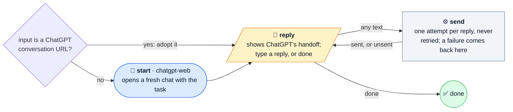

# chatgpt-thread

Keep one ChatGPT web chat going, with a person writing every reply.

After each handoff it shows you ChatGPT's summary. Whatever you type is sent to
the chat unchanged, and `done` ends the run. A reply that fails to send comes
back to you with the error, and is never resent on its own.

**It types into your own ChatGPT account**, in a real browser, and counts
against that account. It needs a running rig-bridge, a signed-in automation
browser profile, and `@dna113p/machines/chatgpt-web` resolvable from this
checkout. It runs from source; the installer never copies it.

| | |
| --- | --- |
| Agent roles | `chatgpt-web` |
| Agent calls, at most | 1, to open the chat; replies are sent by an Operation |
| Source | [chatgpt-thread.ts](../../chatgpt-thread.ts) |

## Input

Plain text, not JSON:

- **A task** starts a fresh chat that works in the current directory.
- **A ChatGPT conversation URL** adopts that chat. Nothing is sent until you reply.

```sh
machine run /absolute/machine-shop/chatgpt-thread.ts "Add a health endpoint"
machine run /absolute/machine-shop/chatgpt-thread.ts "https://chatgpt.com/c/<id>"
```

## Flow

🤖 Agent · ⚙️ Operation · 🧪 check gate · 🙋 Human · ⭘ end ([key](README.md#reading-the-diagrams))



## Results

The run ends ✅ `done` when you type `done`. Its output is the conversation URL
and the last handoff's reason and summary. See the
[catalog](../catalog.md#chatgpt-thread) for the limits.
