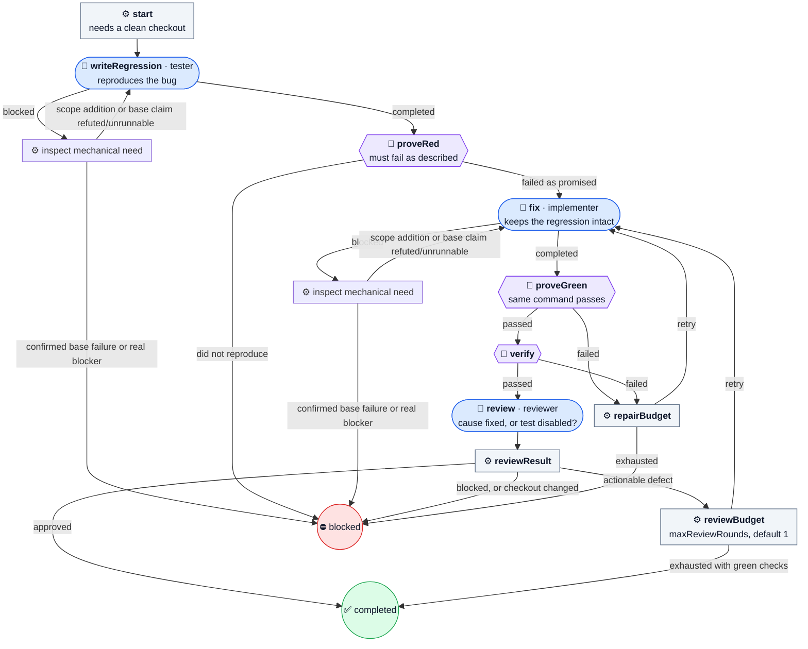

# fix-bug

Prove a bug fails, fix it, prove it passes, then run the checks and review.

The bug has to be caught on camera before anyone fixes it. A tester writes a regression test, and the Machine runs it and requires the exact failure you described. Only then may the implementer fix it, and the same command must pass afterwards. The reviewer reads both logs to make sure the fix addressed the cause and did not just disable the test.

| | |
| --- | --- |
| Agent roles | `tester`, `implementer`, `reviewer` |
| Agent calls, at most | 18 at the default budgets |
| Checkout | clean |
| Source | [fix-bug.ts](../../defaults/fix-bug.ts) |

Malformed Agent reports use [report recovery](../catalog.md#recovery): one
send-back to the same role with the exact fault, retained in stage evidence.
The call ceiling includes these send-backs and the bounded mechanical recovery calls.

## Advisory review

The Agent decides reversible questions and reports `assumptions` as
`[{question, answer, why}]` and `scopeAdditions` as `[{path, why}]`. It runs only
tests for what it changed; the workflow runs every required check.

Review findings are `{severity, kind?, text, where}`. Only a `blocker` whose
`kind` is `acceptance`, `regression`, or `safety` requests a revision. Missing
`kind` counts as `other`; other findings are advisory. An unstructured `revise`
gets one send-back, then stands as a discussion note. `maxReviewRounds` defaults
to 1 and counts revision cycles separately from failed-check `maxRepairs`.
When review rounds run out with green checks, the result is `completed`.
`reviewNotes` holds the last findings; `needs` holds standing defects as
`{kind: "review", text, paths?}`. These fields, `assumptions`, and `scopeAdditions`
are included in the receipt even when empty.

A mechanical `blocked` can name `needs: [{kind: "baseFailing", text, check}]`.
The workflow runs only that configured check, whole and once, in a temporary
detached worktree at the start commit. Ignored dependency directories are linked
from the candidate and removed as links during cleanup. A confirmed nonzero
exit ends `blocked` with the base failure and log path, without another Agent
call. A passing or unrunnable base check returns its evidence to the Agent once.
A `needs: [{kind: "scope", text, paths}]` outside the task's `## Scope` bullets
(or without stated Scope) becomes a scope addition and returns to the Agent.
Scope recovery is allowed once per editing stage; base verification once per run.
A repeated mechanical block or a need requiring a person remains `blocked`.
The candidate is never switched in place. Direct defaults have no setup input;
a custom caller can supply setup commands through the shared runner's policy.

The regression and fix always use separate Agent calls. There is no `testsFirst`
input or task-text switch; the red check remains mandatory.

## Input

A JSON object, given with `--input-file`, as a JSON string, or through MCP or Pi.
Unknown fields are refused.

| Field | Required | Default | Meaning |
| --- | --- | --- | --- |
| `task` | yes | — | What to do, with enough scope and acceptance criteria to act without your conversation. At most 20,000 characters. |
| `workspace` | yes | — | Absolute path to the project's Git checkout root, not a subdirectory. |
| `checks` | yes, 1–20 | — | Commands to run, in order, as `{ name, command, timeoutMs }`. `command` is an argv array with no shell; `timeoutMs` defaults to 60000 and caps at 600000. Every selected check runs even after one fails. |
| `rerunFailedChecks` | no | `true` | Run each failed gate once more, alone, after all gates have run. A passing rerun is marked `flaky`, with both logs kept and no repair round used. Set `false` to require first-time passes. |
| `maxRepairs` | no | `1` | Additional failed-check repairs, 0–3; independent of review revisions. |
| `maxReviewRounds` | no | `1` | Additional review revision cycles, 0–5. Green checks permit completion when exhausted. |
| `regression` | yes | — | The command that reproduces the bug: `{ name, command, timeoutMs, failureExitCode, failureIncludes }`. Before the fix it must exit with `failureExitCode` (1–125) and print `failureIncludes`; after the fix it must exit 0. |

From [examples/bugfix.json](../../examples/bugfix.json):

```json
{
  "task": "Fix empty-input behavior without changing other cases. The regression should assert an empty collection is returned.",
  "workspace": "/absolute/project",
  "checks": [{"name": "tests", "command": ["npm", "test"], "timeoutMs": 120000}],
  "maxRepairs": 1,
  "regression": {
    "name": "empty-input-regression",
    "command": ["node", "--test", "tests/empty-input.test.js"],
    "failureExitCode": 1,
    "failureIncludes": "empty input returns an empty collection"
  }
}
```

### Layered check fields

See [Common input](../catalog.md#layered-checks) for Drip's example: build first;
then types, focused tests, linked-tests, machine-tests, conditional ui and
remote-ui in one group; package-smoke after all of them.

| Field | Required | Default | Meaning |
| --- | --- | --- | --- |
| `checks[].when` | no | `always` | 1–50 Scope path globs. Run if any changed path matches; otherwise record skipped (no changed path matched when). |
| `checks[].focused` | no | `false` | Select named or importing test files and replace a trailing glob argument. Run whole when selection is unsafe or unavailable; delivery reverify always runs whole. |
| `checks[].focusedLimit` | no | `40` | Maximum selected test files, 1–500; only with focused: true. More files runs the whole check. |
| `checks[].group` | no | `none` | Checks sharing a group run concurrently, with one log per check. Ungrouped checks remain sequential. |
| `checks[].after` | no | `[]` | Names that must finish before this check starts; skipped and failed count as finished. Names must be listed earlier in an earlier unit, or belong to the same group; cycles are refused. |
| `checks[].fastMs` | no | `90000` | Fast always-check threshold in milliseconds, 1–600000. Only without when or focused; used when selecting a repair round. |

Paths are measured from the run's start commit, including committed and local
changes. Groups run at their first member's position; other checks stay serial.
[Recovery](../catalog.md#reduced-repair-rounds) runs failed checks and fast
always-checks after failure, then a full layered round before passing. Receipts
name every round's run and skipped checks, reasons and focused files.

The regression command runs whole and alone; it does not accept layered fields.

## Flow

🤖 Agent · ⚙️ Operation · 🧪 check gate · 🙋 Human · ⭘ end ([key](README.md#reading-the-diagrams))



## Results

Every end writes `.machine-runs/machine-shop/<id>/result.json` and returns the
same JSON: `outcome`, `checksPassed`, repairs, Agent calls, check exit codes and
log paths, and each stage's summary.

- ✅ **`done`**, `outcome: completed`: red, then green, checks passed, and advisory review finished.
- ⛔ **`blocked`**, `outcome: blocked`: the regression did not reproduce, an Agent blocked, or the failed-check repair budget ran out.

Read the final state and `outcome`, not only the exit code. The catalog's
[results](../catalog.md#human-decisions-and-results) section has every field.
