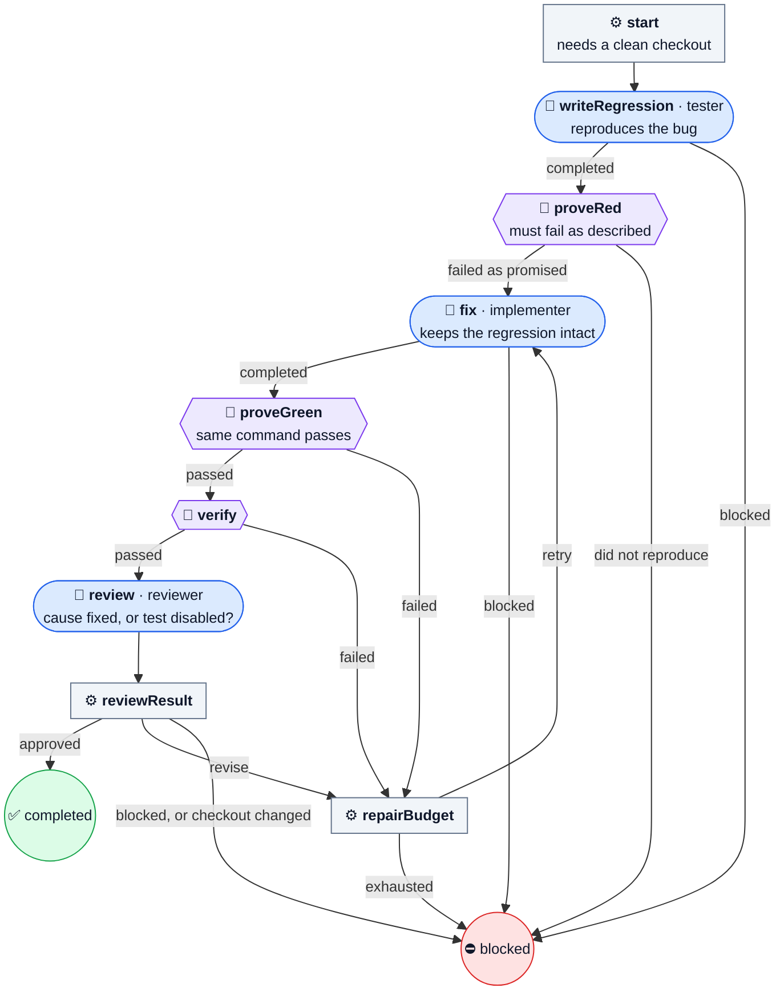

# fix-bug

Prove a bug fails, fix it, prove it passes, then run the checks and review.

The bug has to be caught on camera before anyone fixes it. A tester writes a regression test, and the Machine runs it and requires the exact failure you described. Only then may the implementer fix it, and the same command must pass afterwards. The reviewer reads both logs to make sure the fix addressed the cause and did not just disable the test.

| | |
| --- | --- |
| Agent roles | `tester`, `implementer`, `reviewer` |
| Agent calls, at most | 5 at the default budget |
| Checkout | clean |
| Source | [fix-bug.ts](../../defaults/fix-bug.ts) |

## Input

A JSON object, given with `--input-file`, as a JSON string, or through MCP or Pi.
Unknown fields are refused.

| Field | Required | Default | Meaning |
| --- | --- | --- | --- |
| `task` | yes | — | What to do, with enough scope and acceptance criteria to act without your conversation. At most 20,000 characters. |
| `workspace` | yes | — | Absolute path to the project's Git checkout root, not a subdirectory. |
| `checks` | yes, 1–20 | — | Commands to run, in order, as `{ name, command, timeoutMs }`. `command` is an argv array with no shell; `timeoutMs` defaults to 60000 and caps at 600000. Every check runs even after one fails. |
| `maxRepairs` | no | `1` | How many more rounds a failed check or a `revise` review may get, 0–3. |
| `regression` | yes | — | The command that reproduces the bug: `{ name, command, timeoutMs, failureExitCode, failureIncludes }`. Before the fix it must exit with `failureExitCode` (1–125) and print `failureIncludes`; after the fix it must exit 0. |

From [examples/bugfix.json](../../examples/bugfix.json):

```json
{
  "task": "Fix empty-input behavior without changing other cases. The regression should assert an empty collection is returned.",
  "workspace": "/absolute/project",
  "checks": [{"name": "tests", "command": ["npm", "test"], "timeoutMs": 120000}],
  "maxRepairs": 1,
  "regression": {
    "name": "empty-input-regression",
    "command": ["node", "--test", "tests/empty-input.test.js"],
    "failureExitCode": 1,
    "failureIncludes": "empty input returns an empty collection"
  }
}
```

## Flow

🤖 Agent · ⚙️ Operation · 🧪 check gate · 🙋 Human · ⭘ end ([key](README.md#reading-the-diagrams))



## Results

Every end writes `.machine-runs/machine-shop/<id>/result.json` and returns the
same JSON: `outcome`, `checksPassed`, repairs, Agent calls, check exit codes and
log paths, and each stage's summary.

- ✅ **`done`**, `outcome: completed`: red, then green, checks passed, and the reviewer approved.
- ⛔ **`blocked`**, `outcome: blocked`: the regression did not reproduce, an Agent blocked, or the budget ran out.

Read the final state and `outcome`, not only the exit code. The catalog's
[results](../catalog.md#human-decisions-and-results) section has every field.
