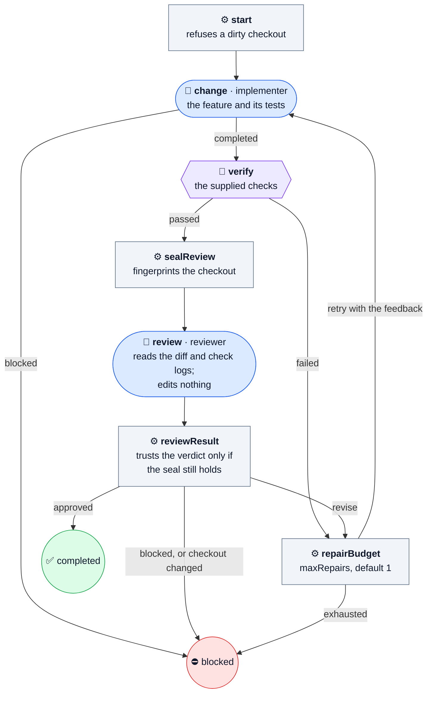

# implement-task

Implement a feature, prove it with the project's checks, and have it reviewed.

The plain feature loop. An implementer makes the change and its tests, the Machine runs the checks, and a reviewer who cannot edit reads the result. A failed check or a `revise` verdict goes back to the implementer within the repair budget. The change stays uncommitted.

| | |
| --- | --- |
| Agent roles | `implementer`, `reviewer` |
| Agent calls, at most | 4 at the default budget |
| Checkout | clean |
| Source | [implement-task.ts](../../defaults/implement-task.ts) |

## Input

A JSON object, given with `--input-file`, as a JSON string, or through MCP or Pi.
Unknown fields are refused.

| Field | Required | Default | Meaning |
| --- | --- | --- | --- |
| `task` | yes | — | What to do, with enough scope and acceptance criteria to act without your conversation. At most 20,000 characters. |
| `workspace` | yes | — | Absolute path to the project's Git checkout root, not a subdirectory. |
| `checks` | yes, 1–20 | — | Commands to run, in order, as `{ name, command, timeoutMs }`. `command` is an argv array with no shell; `timeoutMs` defaults to 60000 and caps at 600000. Every check runs even after one fails. |
| `maxRepairs` | no | `1` | How many more rounds a failed check or a `revise` review may get, 0–3. |

From [examples/implementation.json](../../examples/implementation.json):

```json
{
  "task": "Implement the requested behavior, with acceptance criteria and scope supplied by the orchestrator.",
  "workspace": "/absolute/project",
  "checks": [{"name": "tests", "command": ["npm", "test"], "timeoutMs": 120000}],
  "maxRepairs": 1
}
```

## Flow

🤖 Agent · ⚙️ Operation · 🧪 check gate · 🙋 Human · ⭘ end ([key](README.md#reading-the-diagrams))



## Results

Every end writes `.machine-runs/machine-shop/<id>/result.json` and returns the
same JSON: `outcome`, `checksPassed`, repairs, Agent calls, check exit codes and
log paths, and each stage's summary.

- ✅ **`done`**, `outcome: completed`: checks passed and the reviewer approved.
- ⛔ **`blocked`**, `outcome: blocked`: an Agent blocked, the budget ran out, or the reviewer edited the checkout.

Read the final state and `outcome`, not only the exit code. The catalog's
[results](../catalog.md#human-decisions-and-results) section has every field.
