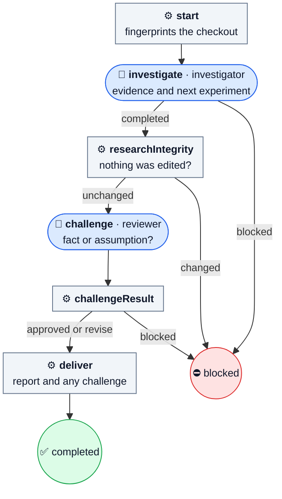

# investigate

Diagnose a bug or answer a technical question, then have the answer challenged.

A diagnosis is delivered together with the skeptic’s objections. The investigator reads the code and primary sources and returns evidence, alternatives, and the smallest next experiment. A reviewer then checks the claims against the source. The challenge is advisory and never triggers another investigation. Nothing is edited.

| | |
| --- | --- |
| Agent roles | `investigator`, `reviewer` |
| Agent calls, at most | 4 at the default budgets |
| Checkout | dirty is fine; it must stay unchanged |
| Source | [investigate.ts](../../defaults/investigate.ts) |

Malformed Agent reports use [report recovery](../catalog.md#recovery): one
send-back to the same role with the exact fault, retained in stage evidence.
The call ceiling includes these send-backs and the bounded mechanical recovery calls.

## Advisory review

One investigator report and one challenge are delivered, without a disagreement
loop. The investigator decides reversible questions and returns `assumptions`
as `[{question, answer, why}]` and `scopeAdditions` as `[{path, why}]`.
The result's `investigation` path names `investigation.md` in the evidence folder.
A `revise` challenge is appended under `## Challenge`, and `challenged` is `true`;
otherwise it is `false`. The run completes in either case. The receipt also
includes `reviewNotes`, `needs`, `assumptions`, and `scopeAdditions` arrays.
A challenger's `blocked` or a changed checkout still prevents completion.

## Input

A JSON object, given with `--input-file`, as a JSON string, or through MCP or Pi.
Unknown fields are refused.

| Field | Required | Default | Meaning |
| --- | --- | --- | --- |
| `task` | yes | — | What to do, with enough scope and acceptance criteria to act without your conversation. At most 20,000 characters. |
| `workspace` | yes | — | Absolute path to the project's Git checkout root, not a subdirectory. |
| `checks` | no | — | Not accepted: this workflow edits nothing and runs no checks. Use [verify-checks](verify-checks.md) for that. |
| `maxRepairs` | no | `1` | Accepted for compatibility, 0–3; unused: there is one investigation and challenge. |
| `maxReviewRounds` | no | `1` | Accepted for compatibility, 0–5; unused: disagreement is appended to the report. |

From [examples/review.json](../../examples/review.json):

```json
{
  "task": "Review the current diff for concrete correctness and regression risks. Cite file/line evidence; leave files unchanged.",
  "workspace": "/absolute/project"
}
```

## Flow

🤖 Agent · ⚙️ Operation · 🧪 check gate · 🙋 Human · ⭘ end ([key](README.md#reading-the-diagrams))



## Results

Every end writes `.machine-runs/machine-shop/<id>/result.json` and returns the
same JSON: `outcome`, `checksPassed`, repairs, Agent calls, check exit codes and
log paths, and each stage's summary.

- ✅ **`done`**, `outcome: completed`: the challenged report is delivered.
- ⛔ **`blocked`**, `outcome: blocked`: the investigator or reviewer blocked, or the checkout changed.

Read the final state and `outcome`, not only the exit code. The catalog's
[results](../catalog.md#human-decisions-and-results) section has every field.
