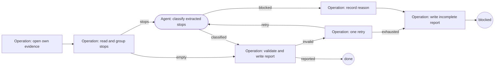

# retrospective

Read ticket-run evidence and report repeated reasons for stopping, with suggested
upstream changes. It writes no ticket and changes no Machine or source file.

| | |
| --- | --- |
| Agent roles | `analyst`, bound to a read-only preset |
| Agent calls, at most | 2; zero when there are no stops |
| Workspace | One or more existing directories; Git is not required |
| Source | [retrospective.ts](../../defaults/retrospective.ts) |

Malformed Agent reports use [report recovery](../catalog.md#recovery): one
send-back to the same role with the exact fault, retained in stage evidence.
The call ceiling includes these send-backs; repair and review budgets are unchanged.

## Input

A JSON object supplied with `--input-file`, as a JSON string, or through MCP or
Pi. Unknown fields are refused. This workflow has its own input schema.

| Field | Required | Default | Meaning |
| --- | --- | --- | --- |
| `workspaces` | yes | — | 1–20 absolute directories whose ticket-task evidence should be read |
| `since` | no | Seven days before the run starts | Valid ISO date, `YYYY-MM-DD`, inclusive from midnight UTC |

```json
{
  "workspaces": ["/absolute/workspace", "/absolute/other-workspace"],
  "since": "2026-10-09"
}
```

The window ends when this retrospective starts. It reads only
`.machine-runs/machine-shop/<run>/` beneath those workspaces: `started.json`,
questions, Human answers, JSON stage reports and `result.json`. It skips its own
folder, other workflows and symlinked run folders, and refuses symlinked evidence
files or roots. It does not follow paths mentioned in the evidence.

Every in-window question is a stop, including one from a run that later completed.
Question times come from file modification times; blocked or failed endings use
`result.json.finishedAt`. Copying evidence with changed modification times can
therefore change which questions fall in the window.

Only Human answers at stage `decide` are paired with questions, in numeric order.
Older runs without question files use the result's reason and answers as one
stop; a completed result with an empty reason uses the answers. Missing ticket
or stage metadata is labeled unknown. A run without `result.json` is not ended:
its in-window questions still count, but the evidence cannot distinguish a
waiting, running or crashed run. Legacy answers without questions or a result
are listed as not ended because no stop time is available. Runs with only
`started.json`, and completed runs without stops, are left out.

Missing or invalid `started.json`, malformed present JSON, invalid required
metadata, unreadable files and more `decide` answers than existing question files
are reported by run name as unreadable. The rest of the report still completes.
Unreadable runs cannot always be dated, so their warnings are retained regardless
of the window.

## Flow



Operations group by workflow, stopped stage and the first sentence of the reason,
normalizing numeric budgets and counts. Both the older standing-text questions
and the request-first layout are read, including discard confirmations and cut
openings. Aliases for question counts, spent budgets and malformed falsify reports
keep the same grouping key across layouts. The ticket id and stopped stage remain
available even before a delivery receipt exists. The analyst receives only those
extracted stops and returns a one-line cause and automation mark for each stop, plus one
suggested change and repository per group. Operations require every stop and
group exactly once. The analyst must not use tools or read or edit files; its
configured harness supplies the read-only permissions, not this workflow.

An automation candidate is an answer taking its falsify question's own recommended
option, merely continuing or fixing reviewer findings, or retrying a mechanical
step. Generic hand-off recommendations never qualify. Operations always override
hand off, archive and discard answers as needing a person, and never mark a stop
without an answer as needing no person. Model judgments remain suggestions for
the report's reader to assess.

## Results

`done` returns and prints Markdown, also saved to
`workspaces[0]/.machine-runs/machine-shop/<id>/report.md`. Its sections are:

1. Stops that needed no person.
2. Repeated causes, most frequent first, with counts, runs, suggestions and repositories.
3. Single stops.
4. Runs not ended.
5. Unreadable runs.

Each stop includes its ticket, workflow, stage, cause and owner's answer. Supplied
file-and-line references are labeled as blocker locations, not the stop decision.
The analyst must leave unsupported repository ownership unknown.

`blocked` means classification failed or remained malformed after one retry.
It still writes and returns an incomplete report containing extracted evidence
and the failure reason. Both endings write the usual `result.json` receipt.

The Machine writes only its own evidence folder in the first named workspace.
It runs no checks or other Machines, never opens or changes tickets, and never
starts, continues or answers a run. Reports do not cause automatic improvements;
a person decides what to do with the suggested changes.
