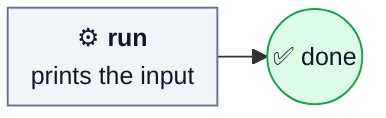

# smoke

Print the input through one Operation, to prove the runtime can load a
definition from this repository. No model and no checks. It runs from source;
the installer never copies it.

| | |
| --- | --- |
| Agent roles | none |
| Source | [smoke.ts](../../smoke.ts) |

## Input

Any text, printed as is. Empty input prints `Machine Shop is connected.`

```sh
machine run /absolute/machine-shop/smoke.ts "hello"
```

## Flow


