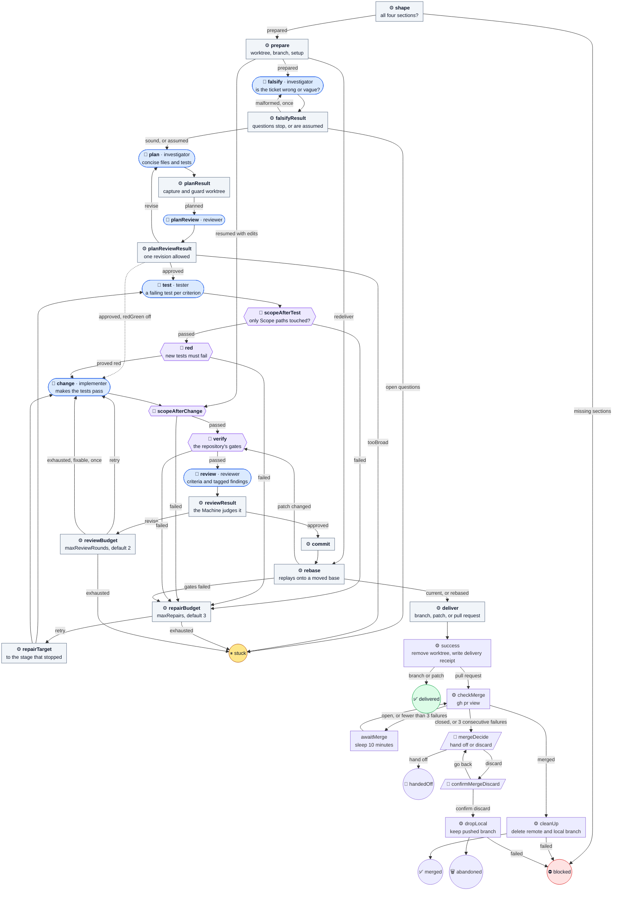

# ticket-task

Carry one local ticket from its own worktree to a delivered branch, patch, or
pull request.

The big one. Planning is read-only, tests come first by default, and the
Machine, not the reviewer, decides whether a review passed. Unlike the defaults,
**it commits**, and with `"output": "pr"` it pushes its own branch and opens a
pull request. It never merges, tags, force-pushes, or touches the source
checkout's working tree. A stuck run sleeps on one Human question, keeping
the worktree and branch until it is answered.

It runs from source; the installer never copies it.

| | |
| --- | --- |
| Agent roles | `investigator`, `tester`, `implementer`, `reviewer` |
| Agent calls, at most | 42 at the default budgets with a stable base; 20 with both budgets at 0 |
| Checkout | its own new worktree; the source checkout is left alone |
| Source | [ticket-task.ts](../../ticket-task.ts) |

Malformed Agent reports use [report recovery](../catalog.md#recovery): one
send-back to the same role with the exact fault, retained in stage evidence.
The call ceiling includes these send-backs; repair and review budgets are unchanged.

## Input

```json
{
  "ticket": {"id": "PROJ-12", "title": "Add the empty state", "body": "## Goal\n…\n## Scope\n- src/widgets/**\n## Acceptance\n- …\n## Forbidden\n- nothing beyond the scope above"},
  "repository": {
    "name": "widgets",
    "path": "/absolute/widgets",
    "base": "main",
    "setup": [{"name": "install", "command": ["npm", "ci"], "timeoutMs": 300000}],
    "checks": [{"name": "tests", "command": ["npm", "test"], "timeoutMs": 120000}],
    "output": "pr"
  },
  "worktreeRoot": "/absolute/worktrees",
  "evidenceRoot": "/absolute/project"
}
```

| Field | Required | Default | Meaning |
| --- | --- | --- | --- |
| `ticket.id` | yes | — | Becomes the branch `ticket/<id>-<title>` and the worktree name. |
| `ticket.title` | yes | — | The commit subject and pull request title. |
| `ticket.body` | yes | — | Markdown with `## Goal`, `## Scope` (paths or globs the change may touch), `## Acceptance` (testable criteria), and `## Forbidden`. A missing section blocks before any Agent runs. |
| `repository.name` | yes | — | One path segment, used in the worktree name. |
| `repository.path` | yes | — | Absolute path to the source checkout root. |
| `repository.base` | no | its HEAD | Branch or ref to start from and rebase onto. In `pr` mode, if this local base is behind the remote base branch, use that branch's published tip instead. No local base or remote-tracking ref moves; `base.json` in the prepare evidence records the local ref and commit, remote, remote branch, and tip used. |
| `repository.setup` | no | none | Commands run in the new worktree before any Agent, such as `npm ci`. Same shape as `checks`. |
| `repository.checks` | yes, 1–20 | — | The gates, as `{ name, command, timeoutMs }` with `command` an argv array. |
| `repository.rerunFailedChecks` | no | `true` | Run each failed gate once more, alone, after all gates have run. A passing rerun is marked `flaky`, with both logs kept and no repair round used. Set `false` to require first-time passes. |
| `repository.redCheck` | no | `"tests"` | The check that must fail after the tester and pass after the implementer. |
| `repository.output` | yes | — | `branch`, `patch`, or `pr`. |
| `repository.remote` | no | `"origin"` | Where `pr` mode pushes. |
| `repository.draft` | no | `true` | Whether `pr` mode opens a draft. |
| `worktreeRoot` | yes | — | Absolute directory for the worktree, outside the repository. |
| `evidenceRoot` | yes | — | Absolute directory for run evidence, outside the repository and worktree. |
| `maxRepairs` | no | `3` | Rounds for a failed scope, red, or green gate, 0–3. |
| `maxReviewRounds` | no | `2` | Rounds for a `revise` review, 0–5. |
| `redGreen` | no | `true` | Write failing tests first. `false` skips the tester and the red check. |
| `assume` | no | `false` | Let `falsify` answer questions whose cautious answer loses nothing, and record them, instead of stopping. |
| `stuck` | no | `"park"` | `stuck` no longer changes anything: both `"park"` and `"ask"` sleep on the same Human question. |
| `resume` | no | `false` | Pick up the worktree a hand-off or block left, or a delivered commit whose worktree is gone. |

In `pr` mode, resume also moves an uncommitted candidate onto the published tip
when the local base is behind. Before delivery, a run whose local base remains
behind its starting commit reads the recorded remote base again: it keeps the
same base if the tip is unchanged, replays onto a newer tip, and refuses a tip
that was rewritten or moved back. A local base with unpublished commits is
still refused.

## Flow

🤖 Agent · ⚙️ Operation · 🧪 check gate · 🙋 Human · ⭘ end ([key](README.md#reading-the-diagrams))

To keep the picture small, two kinds of edge are left out. An Agent that
blocks, and a planning or review result that cannot go on, both go to ⏸ stuck.
A setup, commit, or delivery failure ends ⛔ blocked.



### Resumed conflicts

If moving a resumed candidate onto the current base conflicts, the implementer
removes every conflict marker while keeping both sides' intent, without staging
or committing. The run stages each settled conflict itself, including deletions
as removals. For a conflict without markers, the prompt names the file and what
Git left in the worktree; leaving it alone keeps that version. Files with markers
remain unsettled, count against the repair budget, and are named when the run asks
for help. Once settled, scope checks, required checks, and review run normally.

### When stuck

Once per run, a spent review budget returns to the implementer with a fresh
review budget if the last verdict is `revise`, every finding names a path inside
Scope, at least one is a blocker, and none is a discussion. A leading `./` and
trailing `:line` or `:line-range` are removed before matching Scope. The triggering
blockers stay in the implementer's prompt; repair rounds already used still count.
A second spent budget, any pathless or outside-Scope finding, or no blocker asks
the owner. A `blocked` review still stops immediately. Every stuck question after
the extra round begins says it was used and gives the latest well-formed review's
`newSinceLastRound` from that point, or says no review has finished in it yet.
An owner answer does not grant another automatic extra round.

The plan reviewer prefers concise plans and sends back unnecessary detail as
an ordinary revision. A `tooBroad` verdict stops the run with a suggested split
into smaller tickets in the question; answering or choosing `more rounds`
returns to the planner.

The question describes what stopped the run, what is needed, open questions,
budgets, and evidence locations. Each question is written as `question-<n>.txt`
in the evidence directory, numbered from 1 across re-asks and continuation
after sleep. The four decisions
are suggestions. Any other reply is an answer and works like `more rounds`:
it renews both budgets, clears the owner questions, and returns to the stage
that stopped in the same worktree.
Answers remain under
`Answers from the ticket owner:` in later Agent prompts, including the planner
after a falsify question. Discard still requires its second confirmation.
The four decisions match ignoring case, surrounding whitespace and trailing
punctuation (`. , ; : ! ? …`). The raw reply is kept in the Human evidence,
and the canonical decision is recorded in `delivery.json`; `confirm discard`
and `go back` stay exact.


## Results

After delivery removes the worktree, a pull request run checks `gh pr view`
every 10 minutes until it merges. With the sleep option, as used by Dispatch,
the run sleeps while waiting for the merge, saving its state between checks.
Only a reported merge permits remote branch deletion; an already absent remote
branch counts as deleted. Any other cleanup failure ends `blocked` with a log.

A pull request closed without merging, or three consecutive `gh` failures
(including unexpected states), goes to `mergeDecide` regardless of `stuck`.
It shows the reason and offers only hand off or discard. Hand off keeps the
branch; confirmed discard deletes only the local branch and keeps the pushed
branch. Both leave the ticket open.

The `merged` final returns exactly `{ "action": "complete", "summary": "…" }`,
so Machines Dispatch closes the ticket. Every other final returns exactly
`{ "action": "hold", "summary": "…" }`. `delivery.json` and `result.json`
record delivery once, before waiting; `merge.json` records the later outcome,
pull request URL, branch, check and failure counts, deletion flags, and any
reason or decision. Read that later receipt if cleanup fails after delivery.

- ✅ **`delivered`**: committed and delivered as a branch or patch.
- ✅ **`merged`**: the pull request merged and the ticket branch was deleted locally and remotely.
- 🤝 **`handedOff`**: a person chose to hand the work to someone else; after pull request delivery, the worktree is already gone and the branch is kept.
- 🗑️ **`abandoned`**: archived to `archive/<slug>` and removed, or discarded after a second confirmation.
- ⛔ **`blocked`**: the ticket's shape, setup, commit, delivery, or branch cleanup failed.

The catalog's [ticket delivery](../catalog.md#ticket-delivery) section has the
resume rules, evidence files, and every stop.
