# ticket-task

Carry one local ticket from an isolated Git worktree to a branch, patch, or pull
request. The Machine commits and, in `pr` mode, pushes its branch and opens a
pull request. Delivery ends there. It never merges, tags, or edits the source
checkout's working tree, and it force-pushes only to update a delivered pull
request on resume, with a lease on the delivered commit. This root workflow runs from source; the
installer does not copy it.

Required roles are `implementer` and `reviewer`. `careful` also requires
`investigator` and `tester`.
The optional `presenter` can explain the sole Human question at `stuck`. Scope
decisions use the deterministic question alone so no presenter recommends an answer.

## Levels

| Level | Behavior |
| --- | --- |
| `trusted` | Default. One implementer investigates, decides reversible questions, implements and tests; checks gate delivery and one advisory review can request one revision. |
| `careful` | The original planning, plan review, tester and red-check flow, with hard Scope and its existing review policy. |
| `auto` | The trusted flow delivers before review; the report becomes a pull request comment or branch summary appendix. |

Select `level` in the input. Repository configuration can choose `auto` through
its caller; this workflow does not infer it from repository files.

In trusted and auto runs, Scope and companions guide the implementer. Only
path-like Forbidden entries and `repository.forbidden` stop the scope gate.
A Forbidden bullet must itself be a path or glob, or contain a backticked path
with `/`, `.` or `*`. Prose such as “nothing beyond the scope above” stays
in the Agent prompts. Bare filenames match at any depth. Outside-Scope changes
are recorded with the implementer's reason, or a mechanical explanation when
unreported. A Forbidden hit asks the existing scope question without a
recommendation; the owner's explicit `include` authorizes those exact paths.

The implementer reports `assumptions: [{question, answer, why}]`,
`scopeAdditions: [{path, why}]` and irreversible-only
`openQuestions: [{text, options, recommended, why}]`. It may commit on the ticket
branch; the workflow takes that tree, verifies it and makes one ticket commit.
A blocked report gives `needs: {kind, text, paths?}`: `baseBehind` or `baseFailing`
moves the candidate onto the current base and retries once; `scope` records
its paths and retries once. A second mechanical block, malformed reports after
one send-back, or an irreversible `decision` needs the owner.

Reviews tag every blocker with `kind: acceptance|regression|safety|other`, naming
the unmet criterion, regression or safety defect. Those defects get at most one
implementation revision. All other findings, discussions and minor notes go
into delivery. When review cannot finish or its budget is spent with passing
checks, delivery succeeds as a draft with `## Needs you`. In PR mode this forces
GitHub's real draft flag even if `repository.draft` is false. Failed checks still
use `maxRepairs` and then stop; green never bypasses the verified-tree guard.

Every trusted delivery carries `## Assumptions`, `## Scope additions`,
`## Review notes`, and `## Needs you` when needed. `delivery.json` records the
level, assumptions, additions, and standing `needs` with `draft: true`.
Auto records its post-delivery review verdict and blockers there too. A failed
comment post is recorded as `review.posted: false` with its log; branch and patch
outputs append the report to `branch-summary.md`. Auto review never undoes a
delivery. Merging before review and reopening tickets belong to the landing
step and Dispatch and are outside this workflow.

## Input

```json
{
  "ticket": {"id": "PROJ-12", "title": "Add the empty state", "body": "## Goal\n…\n## Scope\n- src/widgets/**\n## Acceptance\n- …\n## Forbidden\n- nothing beyond the scope above"},
  "repository": {
    "name": "widgets",
    "path": "/absolute/widgets",
    "base": "main",
    "setup": [{"name": "install", "command": ["npm", "ci"], "timeoutMs": 300000}],
    "checks": [{"name": "tests", "command": ["npm", "test"], "timeoutMs": 120000}],
    "output": "pr"
  },
  "worktreeRoot": "/absolute/worktrees",
  "evidenceRoot": "/absolute/project"
}
```

| Field | Required | Default | Meaning |
| --- | --- | --- | --- |
| `level` | no | `"trusted"` | `careful`, `trusted`, or `auto`; selects the state map. |
| `ticket.id` | yes | — | Becomes the branch `ticket/<id>-<title>` and the worktree name. |
| `ticket.title` | yes | — | The commit subject and pull request title. |
| `ticket.body` | yes | — | Markdown with `## Goal`, `## Scope` (paths or globs the change may touch), `## Acceptance` (testable criteria), and `## Forbidden`. A missing section blocks before any Agent runs. |
| `repository.name` | yes | — | One path segment, used in the worktree name. |
| `repository.path` | yes | — | Absolute path to the source checkout root. |
| `repository.companions` | no | `[]` | Array of non-empty strings using the same paths and glob syntax as Scope, for example `["tests/**", "README.md"]`. These paths are in scope for every ticket, in addition to its own Scope. Both scope gates allow them, and all six Agent prompts list them after Scope. |
| `repository.forbidden` | no | `[]` | Non-empty Scope-style path globs that trusted and auto scope gates enforce alongside ticket Forbidden paths. |
| `repository.base` | no | its HEAD | Branch or ref to start from and rebase onto. In `pr` mode, if this local base is behind the remote base branch, use that branch's published tip instead. No local base or remote-tracking ref moves; `base.json` in the prepare evidence records the local ref and commit, remote, remote branch, and tip used. |
| `repository.setup` | no | none | Commands run in the new worktree before any Agent, such as `npm ci`. Same shape as `checks`. |
| `repository.checks` | yes, 1–20 | — | The gates, as `{ name, command, timeoutMs }` with `command` an argv array. |
| `repository.rerunFailedChecks` | no | `true` | Run each failed gate once more, alone, after all gates have run. A passing rerun is marked `flaky`, with both logs kept and no repair round used. Set `false` to require first-time passes. |
| `repository.redCheck` | no | `"tests"` | The check that must fail after the tester and pass after the implementer. |
| `repository.output` | yes | — | `branch`, `patch`, or `pr`. |
| `repository.remote` | no | `"origin"` | Where `pr` mode pushes. |
| `repository.draft` | no | `true` | Whether `pr` mode opens a draft. |
| `worktreeRoot` | yes | — | Absolute directory for the worktree, outside the repository. |
| `evidenceRoot` | yes | — | Absolute directory for run evidence, outside the repository and worktree. |
| `maxRepairs` | no | `3` | Rounds for a failed green gate or delivery replay conflict, 0–3. Scope misses ask the owner immediately and consume no automatic repair rounds. |
| `maxReviewRounds` | no | `2` | `careful` only; trusted and auto ignore this knob. Rounds for a `revise` review, 0–5. |
| `redGreen` | no | `true` | `careful` only; trusted and auto ignore this knob. Write failing tests first. `false` skips the tester and the red check. |
| `assume` | no | `false` | `careful` only; trusted and auto ignore this knob. Record recommended answers to maintainer-level questions whose wrong guess costs at most a review comment, instead of stopping. Non-assumable questions still need the owner. |
| `stuck` | no | `"park"` | `stuck` no longer changes anything: both `"park"` and `"ask"` sleep on the same Human question. |
| `resume` | no | `false` | Pick up the worktree a hand-off or block left, or a delivered commit whose worktree is gone. |

### Layered check fields

See [Common input](../catalog.md#layered-checks) for Drip's example: build first;
then types, focused tests, linked-tests, machine-tests, conditional ui and
remote-ui in one group; package-smoke after all of them.

| Field | Required | Default | Meaning |
| --- | --- | --- | --- |
| `repository.checks[].when` | no | `always` | 1–50 Scope path globs. Run if any changed path matches; otherwise record skipped (no changed path matched when). |
| `repository.checks[].focused` | no | `false` | Select named or importing test files and replace a trailing glob argument. Run whole when selection is unsafe or unavailable; delivery reverify always runs whole. |
| `repository.checks[].focusedLimit` | no | `40` | Maximum selected test files, 1–500; only with focused: true. More files runs the whole check. |
| `repository.checks[].group` | no | `none` | Checks sharing a group run concurrently, with one log per check. Ungrouped checks remain sequential. |
| `repository.checks[].after` | no | `[]` | Names that must finish before this check starts; skipped and failed count as finished. Names must be listed earlier in an earlier unit, or belong to the same group; cycles are refused. |
| `repository.checks[].fastMs` | no | `90000` | Fast always-check threshold in milliseconds, 1–600000. Only without when or focused; used when selecting a repair round. |

Paths are measured from the run's start commit, including committed and local
changes. Groups run at their first member's position; other checks stay serial.
[Recovery](../catalog.md#reduced-repair-rounds) runs failed checks and fast
always-checks after failure, then a full layered round before passing. Receipts
name every round's run and skipped checks, reasons and focused files.

The red proof runs whole. Setup commands refuse layered fields. Delivery reverify applies `when` but always runs focused checks whole.

## Flow

The careful map has 14 working states: six Agents, seven Operations, and one Human.
The four endings are additional. Each Agent validates and records its report
inside its own state, allowing one send-back with the exact fault. This applies
to falsify, plan, plan review, test, implement, and review reports. A second
malformed report stops at `stuck`; both reports remain as evidence. Falsify keeps
its one send-back allowance across owner continuations. Planning
and review guard the sealed checkout, and `judge` applies review policy rather
than trusting the reviewer's verdict word.

```mermaid
flowchart TD
  subgraph careful[careful]
  prepare["prepare: worktree, setup, resume"] --> falsify([falsify])
  prepare -->|failure| stuck{"stuck: owner answer"}
  prepare -->|missing sections or unsafe adoption| refused((refused))
  falsify --> plan([plan]) --> planReview([planReview])
  falsify -->|questions| stuck
  planReview -->|approved| test([test]) --> red["red: scope and prove red"]
  planReview -->|revise once| plan
  planReview -->|too broad| stuck
  planReview -->|redGreen off| implement([implement])
  red -->|passed| implement --> gate["gate: scope and every check"]
  red -->|not red or scope miss| stuck
  gate -->|passed| review(["review: sealed checkout"]) --> judge[judge]
  gate -->|check failed with budget| implement
  gate -->|scope miss| stuck
  gate -->|budget spent| stuck
  judge -->|approved| commit[commit] --> rebase["rebase: turn, replay, gates"]
  judge -->|revise with budget| implement
  judge -->|needs owner| stuck
  rebase -->|validated candidate| deliver[deliver] --> delivered((delivered))
  rebase -->|changed candidate| gate
  rebase -->|conflict with repair budget| implement
  rebase -->|budget spent or failure| stuck
  commit -->|failure| stuck
  deliver -->|failure| stuck
  stuck -->|continue by saved origin| prepare & falsify & plan & test & implement & gate & rebase
  stuck -->|include scope paths| red & gate
  stuck -->|revert scope paths| test & implement
  stuck -->|hand off| handedOff((handedOff))
  stuck -->|discard| abandoned((abandoned))
  end
  subgraph trusted[trusted and auto]
    tprepare[prepare] --> timplement([implement]) --> tgate[gate]
    tgate -->|trusted, green| treview([review]) --> tjudge[judge]
    tjudge -->|advisory or budget spent, green| tcommit[commit]
    tjudge -->|defect, once| timplement
    tgate -->|failed, repair budget| timplement
    tgate -->|Forbidden or failed after repairs| tstuck{stuck}
    timplement -->|irreversible question| tstuck
    tstuck -->|continue by origin| tprepare & timplement & tgate & trebase
    tgate -->|auto, green| tcommit
    tcommit --> trebase[rebase] --> tdeliver[deliver]
    tdeliver -->|trusted| tdone((delivered))
    tdeliver -->|auto| tafter([review after delivery]) --> tpost[postReview] --> tdone
  end
```



The following planning and review-budget details describe `careful`.

`falsify` asks whether the ticket is wrong, already done, impossible, or
underspecified. A path covered by a companion is already in scope and never
needs a question. An answer is assumable when it is what a careful maintainer
of this repository would do without asking, and a wrong guess costs at most a
review comment. Examples include naming, placement within Scope, the shape of
a test, which existing helper to reuse, the wording of documentation, and where
in Scope a new file goes. A product decision, a change to behaviour a user sees,
a path outside the Scope and companions, or anything irreversible such as
deleting, publishing, migrating data, or changing a protocol is never assumable.
The Agent marks the flag; the workflow decides whether to use the answer.
With `assume: true`, assumable answers are recorded in
`ticket-task-assumptions.json` and `## Assumptions`; non-assumable questions
still stop the run. Without it, all questions still stop the run.
`plan` names files and tests, and `planReview` permits one revision.
By default, `test` writes acceptance tests before `red` proves they fail.
`implement` must preserve those tests and stay within Scope and companions.
`gate` checks these paths and runs every configured check, retaining all failures
for the next repair. A path outside Scope and companions stops at `stuck`
immediately, from `red` or `gate`, before checks or another editing Agent call.
The question asks “May this ticket's scope include <paths>?” and shows the stage,
each path's added and removed lines from Git numstat (including untracked files),
and the existing evidence. Binary counts or unavailable diffs are labelled.
It suggests `include`, `revert`, `hand off`, and `discard`, with no recommendation.
A scope miss is never assumed, even with `assume: true`.

`include` adds only those literal paths to the run's effective scope, without
changing the ticket or using a repair round. It returns directly to the stopped
stage: `red` repeats scope and proves red; `gate` repeats scope and every check.
`revert` sends the tester (from `red`) or implementer (from `gate`) back once,
with the paths and the owner's refusal to widen scope as feedback. This
owner-authorized pass counts as one repair, even when the automatic budget is
zero or spent. Other text retains the usual destination and standing feedback.

Repair counters default to 3 (range 0–3); review counters default to 2
(range 0–5). They are updated on transitions and do not consume each other's
budget. Malformed-report send-backs and the one plan revision consume neither.
A spent review budget grants one extra review budget only for a `revise` report
with a blocker, all finding paths in Scope or companions, and no discussion. Repairs already
used still count. The extra allowance is available once per run, including
after owner answers. Its triggering blockers remain in later implementer
prompts, and every later question states that it was used and includes the
latest `newSinceLastRound` or says no review has finished in it yet.
A `blocked` review stops immediately. Unchanged blockers with nothing new and
repeated discussion questions also need the owner. Minor notes are retained
without forcing a revision. With a stable base the ceiling is 42 Agent calls
at default budgets, 20 with both budgets zero, or 18 with `redGreen: false`,
including report send-backs; an ordinary owner continuation grants fresh budgets.
Scope `include` and `revert` preserve the counters already used.

## Continuing a stop

`stuck` saves the origin, reason, original reports and log references before
sleeping. Except for scope misses, its suggestions are `continue`, `hand off`,
and `discard`; free text also continues and stays verbatim in every later Agent prompt. Decision names
ignore case, surrounding whitespace, and trailing punctuation. Empty text
asks again. There is no route straight from `stuck` to `deliver`.

| Origin and reason | Continue destination | What the answer supplies |
| --- | --- | --- |
| `prepare`: setup failed | `prepare` | Retry preparation after the owner resolves the fault. |
| `falsify`: questions | `plan` | Treat the owner's text as assumptions; an explicit scope change returns to `falsify`. |
| `planReview`: too broad | `plan` | Revise the plan using the narrowed scope. |
| `red` or `gate`: scope miss | `include`: same stage; `revert`: `test` or `implement` | Include the exact paths, or authorize one counted repair to revert them. Free text returns to `test` or `implement`. |
| `red`: not red | `test` | Repair the acceptance tests. |
| `gate`: repair budget spent | `implement` | Repair with a fresh budget and the owner's answer. |
| `judge`: review budget spent | `implement` | Address findings with the owner's answer and fresh budgets. |
| `rebase`: conflict with the repair budget spent, or replay failure | `rebase` | Re-enter replay; an uncommitted candidate returns to implementation, gates, and review with a fresh budget. |

A blocked tester or implementer returns to that Agent. A malformed planning
report returns to planning; a malformed review returns to implementation.
Commit failures continue through gates and review. Delivery failures return
through rebase, retaining a known pull request URL so creation is not repeated.
A process restored directly at delivery also stops at `stuck`: its earlier
repository turn no longer protects replay.
A previously reviewed candidate may reuse its review after replay, but a rebase
continuation reruns every gate even when the base is unchanged. In `careful` and `trusted`, an unreviewed
candidate cannot reach commit. `auto` reviews after delivery.

`hand off` ends directly at `handedOff`, retaining the worktree and branch.
`discard` ends directly at `abandoned`, removing this run's worktree and branch.
The suggestion carries discarding metadata so Drip asks for confirmation; there
are no confirmation states in the Machine. Removal errors fail visibly with
retained command evidence.

Each stop writes `question-<n>.txt`, numbered across re-asks and checkpoint
continuations. `stuck.md` retains full selected evidence and a deterministic
HTML page: origin, reason, questions/options, plan, changed files, failing log
tails, review findings and replay conflicts. Each failed log contributes its
last 30 lines, with an independent byte allowance. Escaped pages and presenter
facts stay below 200,000 UTF-8 bytes and mark omitted content. Original reports
and logs remain intact. Missing diffs or logs do not prevent the question.
The optional presenter receives these facts through `presentWith`; the
Machine's fields prevail if the presenter fails or proposes other fields.
Older runtimes rejecting presentation fields receive the original question
and can read the saved page. Unrelated errors propagate.

## Resume and delivery safety

See the catalog’s [Recovery guidance](../catalog.md#recovery) for shared evidence
and budget conventions.

A kept worktree resumes through `prepare`, which validates repository identity,
branch ownership, and ancestry before adopting it. Worktree-local
`ticket-task-resume.json` preserves the saved origin, unanswered scope and falsify
questions, owner answers, plan, and evidence location across separate runs. Unanswered
scope decisions return to `stuck` with their original stage and paths; handing off
never includes them. Unanswered falsify questions return to `stuck`, with their
options and evidence, until the owner answers; handing off does not authorize
planning. Otherwise preparation returns to the saved origin;
a candidate without saved-origin metadata goes through `gate` and review,
while a clean worktree without metadata starts at `falsify`.

The branch is `ticket/<id-slug>-<title-slug>` (or `ticket/<id-slug>` if the title
leaves no slug); the worktree is `<worktreeRoot>/<repository.name>--<id-slug>`.
The id is lowercased with characters outside `[a-z0-9._-]` replaced by `-`.
The title uses lowercase ASCII words separated by `-`, cut at a word boundary
to 48 characters. `branch.<name>.ticket` records ownership. A matching ticket
commit or the legacy exact id-only branch name can also establish ownership.
Unresolved ownership refuses adoption or a second run beside that branch.
The existing branch name survives ticket retitling; another ticket's files and
branches are never cleaned up.

When the base advances, preparation saves an uncommitted candidate in
`saved-candidate.patch` and `refs/machine-shop/saved/<id-slug>/<hash>`, runs
setup on the clean new base, and applies it there. Ignore rules that would drop
added files, unsafe setup output, or changed HEAD restore the candidate and
stop. Conflicts retain both sides in `resume-conflicts.diff` and
`ticket-task-move.json`. The implementer removes conflict markers and preserves
both intents; the Operation stages resolved files and still checks Scope.
A delivery replay conflict takes the same road in the same run: the candidate
is moved onto the tip, and settling it is one repair round within `maxRepairs`,
after which gates, review, commit and replay run again. Each conflict in a run
spends one repair and saves its own candidate (`saved-candidate-<n>.patch` after
the first), so concurrent tickets on one base settle each other's changes
without a person. The run asks the owner only when the repair budget is spent
or the candidate cannot be re-applied to the tip.

Saved `ticket-task-assumptions.json` belongs to the worktree's Git directory,
outside the candidate. Candidate resume validates it before proceeding, records
`assumptions.json` in the new evidence, and includes it in prompts, the PR body,
and `delivery.json`. A clean run's falsification replaces its old assumptions.
Owner-approved scope additions are validated and saved beside assumptions in
`ticket-task-scope.json`, outside the candidate. A separate `resume` keeps them.
Every later Agent sees them after Scope. The PR body and `branch-summary.md`
list them under `## Scope additions` as
`<path>: included by the ticket owner after <stage>`, and `delivery.json` records
their literal paths and stages.
Branch delivery's one-line summary links the Markdown summary.

With no worktree, resume can adopt a recorded delivered commit and continue
at `rebase`. Exactly one owned branch must hold exactly one ticket commit above
an ancestor of the current base, with the expected title and `Ticket: <id>` line.
The local `branch.<name>.ticketDelivered` record must match its tip; an absent
or mismatched delivery record refuses resume without changes. Merge commits,
unrelated history, multiple commits, unresolved siblings, or a changed title
are refused. In `pr` mode resume takes up the delivered pull request and updates
that same pull request in place: before recreating anything it checks that the
base is published and asks the host with `gh pr list` for the pull requests of
the branch in the repository prepare checks. Resume refuses without changes when
the host lists no pull request, more than one in any state, one that was merged
(nothing to rebase) or closed, one whose base is another branch than the run's
base, or one whose head on the host is not the delivered commit because someone
pushed to it. A host that cannot be reached refuses the same way. Recreation runs
setup again; failed setup removes only the recreated worktree, retaining the
branch and delivery record. An unchanged base still runs every gate and records
`redelivered: true` when the same commit is delivered again; in `pr` mode nothing
is pushed and the pull request is left as it was. A changed patch requires a
fresh review, as when a replay conflict is settled as a repair round. A delivered
pull request is updated by pushing the ticket branch with
`--force-with-lease=refs/heads/<branch>:<delivered commit>`, naming the delivered
commit, so a push someone else made in the meantime fails the delivery at
`deliver` and is never overwritten. No new pull request is opened; the
`ticketDelivered` record moves to the new commit after the push, and
`delivery.json` records `pullRequest: "updated"` beside its URL.

Each repository holds one turn from commit through replay, gates and delivery.
The lock under `.machine-runs/repository-turns/` records repository identity,
run ID and PID; waiting publishes its status, and a dead owner's lock is reclaimed
with evidence. Repair, review, Human sleep, completion, and errors release the
turn. Delivery never advances the base or stacks onto another ticket branch.

Commit checks the verified checkout fingerprint, expected tree, branch, HEAD,
subject and ticket line, including after hooks. Replay accepts only a forward
base and an equivalent patch; changed patches return through gates and review.
In `pr` mode the base must be published. The recorded remote URL and base branch
control push and PR creation, independent of other local Git or `gh` settings.
Push sends only the ticket branch, without tags, and without force except the
lease on the delivered commit when resume updates a delivered pull request.
Once that push succeeds, recovery from PR creation or delivery-record failures
keeps the published commit, even if the base advances. Continuation reacquires
the repository turn and reruns every gate on that commit before retrying delivery.
A failed gate keeps the published commit for another continuation; it never
rebases or resets it. An already-created pull request is reused.

## Results

- **`delivered`** succeeds at the branch, patch, or pull request. Worktree cleanup
  failure still succeeds, naming the leftover path and cleanup log.
- **`handedOff`** cancels with the candidate kept for a person or another workflow.
- **`abandoned`** cancels after the person's discard choice removes the candidate.
- **`refused`** fails for malformed tickets, unsafe preparation/adoption, or an
  unverified completion, with the reason retained.

Every ending returns `{ "action": "hold", "summary": "…" }`.
`delivery.json` records the ticket, repository, branch, base, commit, output,
worktree retention/removal, resume details, decisions and review notes.
`result.json` retains helper outcomes, gates, budgets and Agent reports.
Delivery records `branch.<name>.ticketDelivered` before cleanup. PR delivery
does not wait for a merge or delete the pushed branch.

Every state publishes a one-line `now` and note. Stops, delivery and endings
also save `handoff.html` with a recap, changed-file counts, gate chips, log tails,
and review findings. Empty sections are left out; an empty diff says "No code
written yet." Required gate chips appear once verification has run, with any
unrun gates marked skipped. Setup and red-proof checks keep their own labelled
chips whenever they ran. Notes keep the artifact path
after checkpoint continuation, including on runtimes that ignore pages.

## Wrapping it

A wrapper exports its own `default` factory, which calls
`ticketTask(primitives, …)`, and its own `description`. It also re-exports
`agentRoles` and `endings` from `ticket-task.ts`. These lines match the umbrella's
`.machines/ticket.ts`; adjust the import path for your checkout:

```ts
import ticketTask, { agentRoles as ticketTaskRoles } from "../machine-shop/ticket-task.ts";

export const description = "Carry one local ticket using this project's configuration.";
export const agentRoles = ticketTaskRoles;
export { endings } from "../machine-shop/ticket-task.ts";
```

Keep `agentRoles.presenter` in its object form, `{ description, optional: true }`;
the working roles remain strings; the selected map determines which are required. Machines refuses a presenter
declared as a required role. To enable explanations, add `--agent presenter=small`
to your launch command, using a small, read-only model preset listed by
`machine agents`. Leaving it unbound is supported; no umbrella binding is needed.

`ticket-task.ts` declares its endings with `defineEndings`. A module whose final
states take endings must export `endings`, or the run is refused at start.

Run plain `npm ci` in the Machine Shop checkout the wrapper imports from.
`ticket-task.ts` imports `defineEndings` as a value from `@dna113p/machines`, so
that checkout needs its own dependencies installed; otherwise loading fails with
`Cannot find package '@dna113p/machines'`. Do not use `--omit=dev`: the package
is a devDependency in Machine Shop. Machine Shop requires `^0.8.0`, which allows
presenters to recommend suggestions as well as restricted choices.
