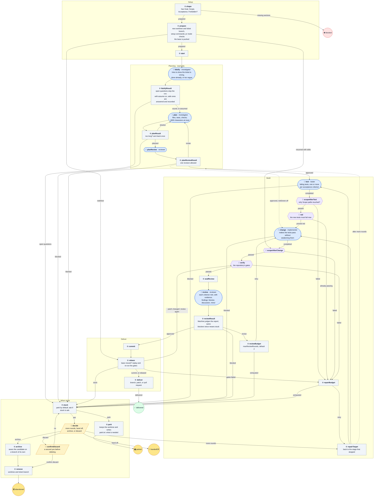

# ticket-task

Carry one local ticket from its own worktree to a delivered branch, patch, or
pull request.

The big one. Planning is read-only, tests come first by default, and the
Machine, not the reviewer, decides whether a review passed. Unlike the defaults,
**it commits**, and with `"output": "pr"` it pushes its own branch and opens a
pull request. It never merges, tags, force-pushes, or touches the source
checkout's working tree. A stuck run parks by default: it stops at once, keeps
the worktree, and writes `park.txt` saying what it needs.

It runs from source; the installer never copies it.

| | |
| --- | --- |
| Agent roles | `investigator`, `tester`, `implementer`, `reviewer` |
| Agent calls, at most | 16 at the default budgets with a stable base; 9 with both budgets at 0 |
| Checkout | its own new worktree; the source checkout is left alone |
| Source | [ticket-task.ts](../../ticket-task.ts) |

## Input

```json
{
  "ticket": {"id": "PROJ-12", "title": "Add the empty state", "body": "## Goal\n…\n## Scope\n- src/widgets/**\n## Acceptance\n- …\n## Forbidden\n- nothing beyond the scope above"},
  "repository": {
    "name": "widgets",
    "path": "/absolute/widgets",
    "base": "main",
    "setup": [{"name": "install", "command": ["npm", "ci"], "timeoutMs": 300000}],
    "checks": [{"name": "tests", "command": ["npm", "test"], "timeoutMs": 120000}],
    "output": "pr"
  },
  "worktreeRoot": "/absolute/worktrees",
  "evidenceRoot": "/absolute/project"
}
```

| Field | Required | Default | Meaning |
| --- | --- | --- | --- |
| `ticket.id` | yes | — | Becomes the branch `ticket/<id>-<title>` and the worktree name. |
| `ticket.title` | yes | — | The commit subject and pull request title. |
| `ticket.body` | yes | — | Markdown with `## Goal`, `## Scope` (paths or globs the change may touch), `## Acceptance` (testable criteria), and `## Forbidden`. A missing section blocks before any Agent runs. |
| `repository.name` | yes | — | One path segment, used in the worktree name. |
| `repository.path` | yes | — | Absolute path to the source checkout root. |
| `repository.base` | no | its HEAD | Branch or ref to start from and rebase onto. |
| `repository.setup` | no | none | Commands run in the new worktree before any Agent, such as `npm ci`. Same shape as `checks`. |
| `repository.checks` | yes, 1–20 | — | The gates, as `{ name, command, timeoutMs }` with `command` an argv array. |
| `repository.redCheck` | no | `"tests"` | The check that must fail after the tester and pass after the implementer. |
| `repository.output` | yes | — | `branch`, `patch`, or `pr`. |
| `repository.remote` | no | `"origin"` | Where `pr` mode pushes. |
| `repository.draft` | no | `true` | Whether `pr` mode opens a draft. |
| `worktreeRoot` | yes | — | Absolute directory for the worktree, outside the repository. |
| `evidenceRoot` | yes | — | Absolute directory for run evidence, outside the repository and worktree. |
| `maxRepairs` | no | `3` | Rounds for a failed scope, red, or green gate, 0–3. |
| `maxReviewRounds` | no | `2` | Rounds for a `revise` review, 0–5. |
| `redGreen` | no | `true` | Write failing tests first. `false` skips the tester and the red check. |
| `assume` | no | `false` | Let `falsify` answer questions whose cautious answer loses nothing, and record them, instead of stopping. |
| `stuck` | no | `"park"` | `"park"` stops at once; `"ask"` waits for a person to choose more rounds, hand off, archive, or discard. |
| `resume` | no | `false` | Pick up the worktree a park or hand-off left, or a delivered commit whose worktree is gone. |

## Flow

🤖 Agent · ⚙️ Operation · 🧪 check gate · 🙋 Human · ⭘ end ([key](README.md#reading-the-diagrams))

Any setup, commit, archive, or delivery failure ends ⛔ blocked; those edges are
left out to keep the picture readable.



## Results

The output is always `{ "action": "hold", "summary": "…" }`, so a Machines
Dispatch ticket stays open until a person merges or closes it. `delivery.json`
in the evidence folder records the outcome, branch, commit, and anything assumed.

- ✅ **`delivered`**: committed and delivered as a branch, patch, or pull request.
- 🅿️ **`parked`**: stuck; the worktree is kept and `park.txt` says what is needed.
  Answer in the ticket and run again with `"resume": true`.
- 🤝 **`handedOff`**: a person chose to hand the uncommitted work to someone else.
- 🗑️ **`abandoned`**: archived to `archive/<slug>` and removed, or discarded after a second confirmation.
- ⛔ **`blocked`**: the ticket's shape, setup, commit, or delivery failed.

The catalog's [ticket delivery](../catalog.md#ticket-delivery) section has the
resume rules, evidence files, and every stop.
