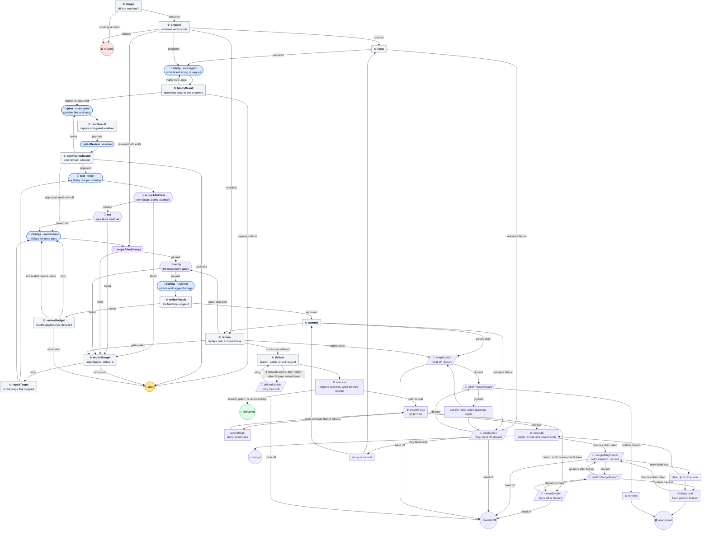
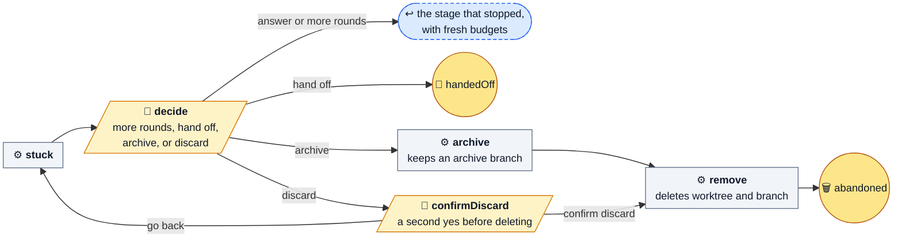

# ticket-task

Carry one local ticket from its own worktree to a delivered branch, patch, or
pull request.

The big one. Planning is read-only, tests come first by default, and the
Machine, not the reviewer, decides whether a review passed. Unlike the defaults,
**it commits**, and with `"output": "pr"` it pushes its own branch and opens a
pull request. It never merges, tags, force-pushes, or touches the source
checkout's working tree. A stuck run sleeps on one Human question, keeping
the worktree and branch until it is answered.

It runs from source; the installer never copies it.

| | |
| --- | --- |
| Agent roles | `investigator`, `tester`, `implementer`, `reviewer` |
| Agent calls, at most | 42 at the default budgets with a stable base; 20 with both budgets at 0 |
| Checkout | its own new worktree; the source checkout is left alone |
| Source | [ticket-task.ts](../../ticket-task.ts) |

Each falsify, plan, plan review, test, change, and review report gets one
send-back to the same Agent state and role with the exact validation fault,
using [report recovery](../catalog.md#recovery). The run status says the report
was sent back. A second malformed plan, plan review, test, change, or review
report takes the existing stuck route with `<stage> report was malformed twice:
<fault>` and the path of the retained report. Both malformed reports are kept.
The call ceiling includes these send-backs; they spend no repair round, review
round, or plan revision.

## Input

```json
{
  "ticket": {"id": "PROJ-12", "title": "Add the empty state", "body": "## Goal\n…\n## Scope\n- src/widgets/**\n## Acceptance\n- …\n## Forbidden\n- nothing beyond the scope above"},
  "repository": {
    "name": "widgets",
    "path": "/absolute/widgets",
    "base": "main",
    "setup": [{"name": "install", "command": ["npm", "ci"], "timeoutMs": 300000}],
    "checks": [{"name": "tests", "command": ["npm", "test"], "timeoutMs": 120000}],
    "output": "pr"
  },
  "worktreeRoot": "/absolute/worktrees",
  "evidenceRoot": "/absolute/project"
}
```

| Field | Required | Default | Meaning |
| --- | --- | --- | --- |
| `ticket.id` | yes | — | Becomes the branch `ticket/<id>-<title>` and the worktree name. |
| `ticket.title` | yes | — | The commit subject and pull request title. |
| `ticket.body` | yes | — | Markdown with `## Goal`, `## Scope` (paths or globs the change may touch), `## Acceptance` (testable criteria), and `## Forbidden`. A missing section blocks before any Agent runs. |
| `repository.name` | yes | — | One path segment, used in the worktree name. |
| `repository.path` | yes | — | Absolute path to the source checkout root. |
| `repository.base` | no | its HEAD | Branch or ref to start from and rebase onto. In `pr` mode, if this local base is behind the remote base branch, use that branch's published tip instead. No local base or remote-tracking ref moves; `base.json` in the prepare evidence records the local ref and commit, remote, remote branch, and tip used. |
| `repository.setup` | no | none | Commands run in the new worktree before any Agent, such as `npm ci`. Same shape as `checks`. |
| `repository.checks` | yes, 1–20 | — | The gates, as `{ name, command, timeoutMs }` with `command` an argv array. |
| `repository.rerunFailedChecks` | no | `true` | Run each failed gate once more, alone, after all gates have run. A passing rerun is marked `flaky`, with both logs kept and no repair round used. Set `false` to require first-time passes. |
| `repository.redCheck` | no | `"tests"` | The check that must fail after the tester and pass after the implementer. |
| `repository.output` | yes | — | `branch`, `patch`, or `pr`. |
| `repository.remote` | no | `"origin"` | Where `pr` mode pushes. |
| `repository.draft` | no | `true` | Whether `pr` mode opens a draft. |
| `worktreeRoot` | yes | — | Absolute directory for the worktree, outside the repository. |
| `evidenceRoot` | yes | — | Absolute directory for run evidence, outside the repository and worktree. |
| `maxRepairs` | no | `3` | Rounds for a failed scope, red, or green gate, 0–3. |
| `maxReviewRounds` | no | `2` | Rounds for a `revise` review, 0–5. |
| `redGreen` | no | `true` | Write failing tests first. `false` skips the tester and the red check. |
| `assume` | no | `false` | Let `falsify` answer questions whose cautious answer loses nothing, and record them, instead of stopping. |
| `stuck` | no | `"park"` | `stuck` no longer changes anything: both `"park"` and `"ask"` sleep on the same Human question. |
| `resume` | no | `false` | Pick up the worktree a hand-off or block left, or a delivered commit whose worktree is gone. |

Each repository has one turn from commit through rebase, repeated gates and delivery.
A lock beside the worktrees directory, under `.machine-runs/repository-turns/`,
records the run ID and PID using the canonical Git repository identity. Other
runs poll and publish `<title>: waiting for the repository's turn` in the run
status, restoring the active sentence when they acquire the turn or stop;
a stale lock whose PID is gone is reclaimed
with a log line. A waiting run replays onto the current base and runs
the gates again when it moved. The turn is released before repair, review,
a person’s decision, completion or a stopped run. A replay conflict uses the
existing once-per-run repair allowance, reacquiring the turn before commit and
replay; a second conflict keeps the existing stop. Delivery never advances the
base itself or stacks onto unmerged ticket branches.

Every state publishes one sentence about the ticket in both `now` and `note`,
including after checkpoint continuation. For example, falsification says
`<title>: checking whether the ticket is sound`, planning says
`<title>: planning; the plan review is next`, tests say
`<title>: writing the failing tests`, and implementation says
`<title>: implementing; gates not yet run`. Gates name the configured checks,
such as `<title>: running lint, types, tests`. Review names the current attempt
and its budget, counting the initial review plus permitted revisions:
`<title>: under review, round 1 of 2`. An extra review budget is identified explicitly.
A stop says `<title>: stuck at <stage>, needs you`; pull request delivery says
`<title>: delivered as pull request #N`. Merge waiting, cleanup, and every ending
have their own sentences. Releasing the repository turn never clears the status.

Whitespace is collapsed to keep each sentence on one line. Sentences are limited
to 200 Unicode characters; long titles are shortened with an ellipsis without
splitting a Unicode character, preserving the stage meaning. An unusually long
stage description (such as a list of check names) is capped at 160 characters
to leave room for the title. The identical `note` supports runtimes that silently
ignore `now`. Explicit unknown-`now` validation errors retry with only `note`;
unrelated status errors still fail visibly.

In `pr` mode, resume also moves an uncommitted candidate onto the published tip
when the local base is behind. Before delivery, a run whose local base remains
behind its starting commit reads the recorded remote base again: it keeps the
same base if the tip is unchanged, replays onto a newer tip, and refuses a tip
that was rewritten or moved back. A local base with unpublished commits is
still refused.

## Flow

🤖 Agent · ⚙️ Operation · 🧪 check gate · 🙋 Human · ⭘ end ([key](README.md#reading-the-diagrams))

To keep the picture small, two kinds of edge are left out. An Agent that
blocks, and a planning or review result that cannot go on, both go to ⏸ stuck.
Expected operational failures follow the recovery paths below.



### Resumed conflicts and replay conflicts at delivery

On a delivery replay conflict, the run restores the approved candidate, moves it
onto the tip it tried, and sends conflicts to the implementer in the same run.
The run moves once; a second replay conflict stops with the existing recovery text
and says the run already moved its candidate once.
A move in `prepare` when the run resumed counts toward this once-per-run limit.
The settling round uses the existing repair budget, and the moved change gets a
fresh review after scope and required checks, before commit, rebase, and delivery.
Evidence names the replay conflict, its files, and the tip the candidate moved onto.
A replay refused by Git or a hook without conflicts, a rewritten base, an
unpublished base, or a base that already holds the change still stops as before.

This removes the manual handoff and resume needed on 2026-10-19 for org-26
(replay onto `9a2d15a` conflicted in `tests/ticket-task.test.ts`) and org-47
(replay onto `0bc2c5a` conflicted in `ticket-task.ts`). Both resumed runs used
this same move and settling path to deliver.

If moving a candidate onto the current base conflicts, the implementer
removes every conflict marker while keeping both sides' intent, without staging
or committing. The run stages each settled conflict itself, including deletions
as removals. For a conflict without markers, the prompt names the file and what
Git left in the worktree; leaving it alone keeps that version. Files with markers
remain unsettled, count against the repair budget, and are named when the run asks
for help. Once settled, scope checks, required checks, and review run normally.

### When stuck

Once per run, a spent review budget returns to the implementer with a fresh
review budget if the last verdict is `revise`, every finding names a path inside
Scope, at least one is a blocker, and none is a discussion. A leading `./` and
trailing `:line` or `:line-range` are removed before matching Scope. The triggering
blockers stay in the implementer's prompt; repair rounds already used still count.
A second spent budget, any pathless or outside-Scope finding, or no blocker asks
the owner. A `blocked` review still stops immediately. Every stuck question after
the extra round begins says it was used and gives the latest well-formed review's
`newSinceLastRound` from that point, or says no review has finished in it yet.
An owner answer does not grant another automatic extra round.

The plan reviewer prefers concise plans and sends back unnecessary detail as
an ordinary revision. A `tooBroad` verdict stops the run with a suggested split
into smaller tickets in the question; answering or choosing `more rounds`
returns to the planner.

The question starts with what is needed: the number of open questions, the
malformed report's fault, or the spent budget. Its opening is at most 100
characters, cut at a word boundary with an ellipsis when needed. Then it gives
the ticket id without its title, the stopped stage, budgets and any extra review
round, followed by the questions or remaining reason once, and evidence locations.
Discard confirmation keeps the same order, with the stop reason under Needs.
Each question is written as `question-<n>.txt` in the evidence directory, numbered from 1 across re-asks and continuation
after sleep. The four decisions
are suggestions. Any other reply is an answer and works like `more rounds`:
it renews both budgets, clears the owner questions, and returns to the stage
that stopped in the same worktree.
Answers remain under
`Answers from the ticket owner:` in later Agent prompts, including the planner
after a falsify question. Discard still requires its second confirmation.
The four decisions match ignoring case, surrounding whitespace and trailing
punctuation (`. , ; : ! ? …`). The raw reply is kept in the Human evidence,
and the canonical decision is recorded in `delivery.json`; `confirm discard`
and `go back` stay exact.



## Recovery by step

Every retry reruns only the failed Operation, without a new commit or review.
Automatic retries use Operation `retry`: 3 further attempts, each after `1m`
(one minute). Only `deliver`, `cleanUp`, and `dropLocal` retry automatically.
Questions are saved as `question-<n>.txt` and answered through the usual Human
interface. Choices are restricted to the actions available at that step.

All nine stop questions use the optional `presenter` role: `decide`,
`confirmDiscard`, `stepDecide`, `keepDecide`, `deliverDecide`,
`confirmStepDiscard`, `mergeDecide`, `mergeRetryDecide` and `confirmMergeDiscard`.
Each question gets a deterministic page, headline, effects for every offered
choice and a recommendation, without a model call. The page carries the repository,
ticket id and title, branch and worktree, followed by a sentence naming the stopped
stage and reason. Saved evidence includes questions with options and recommendations,
the plan and plan-review objection, a changed-files table with diff stat, failing
gate log tails, unmet review criteria and open findings, and replay conflict paths
with the saved candidate reference. Missing logs or diffs are identified explicitly.
After worktree removal, the diff compares the saved base and delivered commit.

The page uses escaped Drip kit HTML: recap sections, status chips, tables with
headers and preformatted logs. It contains no scripts, styles or links. Gate logs
contribute their last 30 lines. Each failing gate gets its own budget for its
identity and diagnostic tail in both the page and presenter facts, before passing
check metadata. Oversized tails retain their end. Every variable block is byte-budgeted after HTML
escaping, keeping the whole page below 200,000 UTF-8 bytes. Each cut says how much
was omitted and points to `stuck.md`. The same evidence goes to the optional
presenter through `presentWith`, with an independent serialized-facts byte budget.
The presenter also receives the run's map and history from Machines.

Before the Human waits, `stuck.md` in the run's evidence directory receives the full
selected evidence and generated page. It is refreshed on re-entry and confirmations;
numbered `question-<n>.txt` files and original logs remain intact. This also works
after sleep and after the worktree is removed. An older runtime rejecting the
presentation fields receives the original request, while the generated page stays
in `stuck.md` only. Other validation errors propagate.

The Machine's presentation fields take precedence over optional presenter output
and remain available without a presenter or if it fails. `hand off` is recommended,
or `go back` for discard confirmations. Destructive choices are marked. The choices,
suggestions, answer matching and endings stay the same.

| Step | Recovery |
| --- | --- |
| `shape` | Missing ticket sections end `refused`, a declared failed ending, with the reason. |
| `prepare` | Refusals before creating a worktree end `refused` without a question or cleanup. New-worktree setup runs separately in `setup`. Delivered-resume adoption refusals retain the delivery record and remove only the recreated worktree; failed removal names the kept worktree. |
| `setup` | A failed configuration or setup command, or leftover files, asks `retry`, `hand off`, or `discard`. |
| `commit` | A failed `git commit` asks `retry`, `hand off`, or `discard`. An empty candidate, stale checks, or changed HEAD, branch, commit content, or message asks only `hand off` or `discard`. |
| `rebase` | Red checks on a redelivered commit enter the repair loop. A replay conflict moves the candidate onto the attempted tip and sends conflicts to the implementer once in the same run, then scope, checks, and fresh review; a prior move in `prepare` counts, and a second conflict stops. A rewritten or backward base asks only `hand off` or `discard`; an unresolved base during delivered-resume verification ends `refused`. |
| `deliver` | Push and `gh` failures retry automatically, then ask `retry` or `hand off`. Other delivery failures ask immediately. A known pull request URL is reused on retry. |
| `success` | Failure to remove the worktree still ends `delivered` immediately, naming the worktree and `git-worktree.log`; no merge wait starts. |
| `cleanUp` | Retry automatically, then ask the merge decision with `retry` added: `retry`, `hand off`, or `discard`. |
| `dropLocal` | Retry automatically, then ask `retry`, `hand off`, or `discard`. Retry returns only to this failed step. |
| `archive` | A failure throws and fails the run visibly with the error and any log; the owner already chose archive. |
| `remove` | A failure throws and fails the run visibly with the error and any log; the owner already authorized removal. |

`discard` always asks for confirmation. Before delivery it removes the worktree
and ticket branch; during the merge wait it removes only the local branch.
`hand off` keeps the remaining work. Neither choice grants extra repair or
review rounds.

## Results

`delivered` and `merged` are declared successful endings. `handedOff` and
`abandoned` are declared cancelled endings because they follow a person's
choice to stop this run; they do not claim the ticket was completed.
`refused` is a declared failed ending, with the reason recorded.

After delivery removes the worktree, a pull request run checks `gh pr view`
every 10 minutes until it merges. With the sleep option, as used by Dispatch,
the run sleeps while waiting for the merge, saving its state between checks.
Only a reported merge permits remote branch deletion; an already absent remote
branch counts as deleted. Other cleanup failures retry and then ask the merge decision with `retry` added.

A pull request closed without merging, or three consecutive `gh` failures
(including unexpected states), goes to `mergeDecide` regardless of `stuck`.
It shows the reason and offers only hand off or discard. Hand off keeps the
branch; confirmed discard deletes only the local branch and keeps the pushed
branch. Both leave the ticket open.

The `merged` final returns exactly `{ "action": "complete", "summary": "…" }`,
so Machines Dispatch closes the ticket. Every other final returns exactly
`{ "action": "hold", "summary": "…" }`. `delivery.json` and `result.json`
record delivery once, before waiting; `merge.json` records the later outcome,
pull request URL, branch, check and failure counts, deletion flags, and any
reason or decision. Read that later receipt after a merge decision.
A delivered ticket with a kept worktree records `delivery.json` outcome
`delivered`, `worktreeRemoved: false`, and no reason; `result.json` records
`completed` with an empty reason. Refusals record `refused` in `delivery.json`
and retain the helper's `blocked` outcome in `result.json`.

- ✅ **`delivered`**: committed and delivered as a branch or patch, or as a pull request whose worktree could not be removed.
- ✅ **`merged`**: the pull request merged and the ticket branch was deleted locally and remotely.
- 🤝 **`handedOff`**: a person chose to hand the work to someone else; after pull request delivery, the worktree is already gone and the branch is kept.
- 🗑️ **`abandoned`**: archived to `archive/<slug>` and removed, or discarded after a second confirmation.
- ⛔ **`refused`**: the ticket shape or preparation was refused, or final verification could not be confirmed, with the reason. This is a declared failed ending; `delivered` and `merged` are succeeded endings, and `handedOff` and `abandoned` are cancelled endings.

The catalog's [ticket delivery](../catalog.md#ticket-delivery) section has the
resume rules, evidence files, and every stop.

## Wrapping it

A wrapper exports its own `default` factory, which calls
`ticketTask(primitives, …)`, and its own `description`. It also re-exports
`agentRoles` and `endings` from `ticket-task.ts`. These lines match the umbrella's
`.machines/ticket.ts`; adjust the import path for your checkout:

```ts
import ticketTask, { agentRoles as ticketTaskRoles } from "../machine-shop/ticket-task.ts";

export const description = "Carry one local ticket using this project's configuration.";
export const agentRoles = ticketTaskRoles;
export { endings } from "../machine-shop/ticket-task.ts";
```

Keep `agentRoles.presenter` in its object form, `{ description, optional: true }`;
the four working roles remain required strings. Machines refuses a presenter
declared as a required role. To enable explanations, add `--agent presenter=small`
to your launch command, using a small, read-only model preset listed by
`machine agents`. Leaving it unbound is supported; no umbrella binding is needed.

`ticket-task.ts` declares its endings with `defineEndings`. A module whose final
states take endings must export `endings`, or the run is refused at start.

Run plain `npm ci` in the Machine Shop checkout the wrapper imports from.
`ticket-task.ts` imports `defineEndings` as a value from `@dna113p/machines`, so
that checkout needs its own dependencies installed; otherwise loading fails with
`Cannot find package '@dna113p/machines'`. Do not use `--omit=dev`: the package
is a devDependency in Machine Shop. Machine Shop requires `^0.7.1`, which allows
presenters to recommend suggestions as well as restricted choices.
