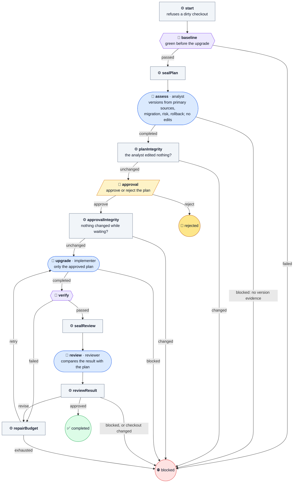

# upgrade-dependency

Plan a dependency upgrade, get a person's approval, then upgrade and verify.

Nothing is installed until a person approves the plan. An analyst confirms the versions from primary sources and proposes migration steps, risks, and a rollback. A changed checkout while the plan waits for approval voids it. After approval, the implementer applies only that plan, and the result is checked and reviewed against it.

| | |
| --- | --- |
| Agent roles | `analyst`, `implementer`, `reviewer` |
| Agent calls, at most | 5 at the default budget |
| Checkout | clean |
| Source | [upgrade-dependency.ts](../../defaults/upgrade-dependency.ts) |

## Input

A JSON object, given with `--input-file`, as a JSON string, or through MCP or Pi.
Unknown fields are refused.

| Field | Required | Default | Meaning |
| --- | --- | --- | --- |
| `task` | yes | — | What to do, with enough scope and acceptance criteria to act without your conversation. At most 20,000 characters. |
| `workspace` | yes | — | Absolute path to the project's Git checkout root, not a subdirectory. |
| `checks` | yes, 1–20 | — | Commands to run, in order, as `{ name, command, timeoutMs }`. `command` is an argv array with no shell; `timeoutMs` defaults to 60000 and caps at 600000. Every check runs even after one fails. |
| `maxRepairs` | no | `1` | How many more rounds a failed check or a `revise` review may get, 0–3. |

From [examples/upgrade.json](../../examples/upgrade.json):

```json
{
  "task": "Assess an explicitly named dependency and target version supplied by the orchestrator; request approval before changing it.",
  "workspace": "/absolute/project",
  "checks": [{"name": "tests", "command": ["npm", "test"], "timeoutMs": 120000}],
  "maxRepairs": 1
}
```

## Flow

🤖 Agent · ⚙️ Operation · 🧪 check gate · 🙋 Human · ⭘ end ([key](README.md#reading-the-diagrams))



## Results

Every end writes `.machine-runs/machine-shop/<id>/result.json` and returns the
same JSON: `outcome`, `checksPassed`, repairs, Agent calls, check exit codes and
log paths, and each stage's summary.

- ✅ **`done`**, `outcome: completed`: approved, upgraded, checks passed, and the reviewer approved.
- ⛔ **`blocked`**, `outcome: blocked`: the baseline was red, the version evidence was missing, the checkout changed, or the budget ran out.
- 🚫 **`rejected`**, `outcome: rejected`: the person said `reject`. Nothing is inferred from silence.

Read the final state and `outcome`, not only the exit code. The catalog's
[results](../catalog.md#human-decisions-and-results) section has every field.
